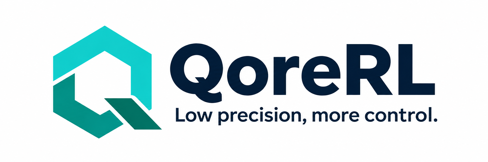
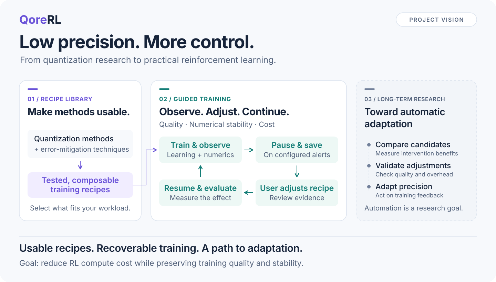

# QoreRL



<picture>
  <source media="(prefers-color-scheme: dark)" srcset="docs/assets/qorerl-overview-dark.svg">
  
</picture>

QoreRL is an early-stage, quantization-native reinforcement learning framework being built to make low-precision methods easier to reproduce, compare, and use in training.

The first milestone focuses on configurable precision recipes, numerical diagnostics, and a guided recovery workflow: observe a run, preserve recoverable state when problems arise, present evidence and supported options, and let the user adjust the configuration before resuming. Automatic precision adaptation remains an ongoing research goal, not a prerequisite for a useful first release.

> **Current implementation:** synchronous GRPO coordinated by Ray, with Megatron/vLLM adapters and the first experimental recipes: MXFP8 MLP down projections, with or without fixed Hadamard rotation. Local tests cover training orchestration, transformations, recipe state, refits, and same-configuration recovery. **Native GPU execution, learning quality, and performance remain unvalidated.** Configurable alert-driven pause and recipe-changing recovery are upcoming milestones.

The [first recipe guide (中文)](docs/recipes/mxfp8-hadamard.zh-CN.md) includes matched BF16 / MXFP8 / MXFP8 + Hadamard configurations, execution scope, known costs, and the GPU validation procedure. These are experimental implementations, not yet validated recommendations.

Recipe Insights makes each recipe's costs and numerical effects visible, layer by layer. Opt-in probes compare BF16, MXFP8, and MXFP8 + Hadamard on the same sampled learner inputs and weights. View the accumulating evidence locally, inspect individual layers, and export a report or chart for sharing. [Usage and measurement scope (中文)](docs/recipe-insights.zh-CN.md).


*Interface preview with synthetic data. Native GPU measurements and training benefits remain unvalidated.*

## Recipe catalog and roadmap

This catalog tracks quantization methods, error-mitigation techniques, and RL corrections available or planned for QoreRL recipes, along with research candidates. Status refers to **QoreRL integration**, not the maturity of the original paper. Last reviewed: **2026-11-17**.

- **Implemented:** code and local tests are available; native GPU validation is still pending.
- **Planned:** selected for implementation, but not available yet.
- **Research:** a candidate to evaluate before committing to an implementation.

**Current focus:** validate the existing BF16 / MXFP8 / fixed-Hadamard paths on GPUs and publish paired measurements through Recipe Insights. GPU runs are pending; the research entries below are not active implementations.

| Recipe / technique | Status | What it is intended to improve | Scope and source |
| --- | --- | --- | --- |
| **BF16 reference** | Implemented | Provide a matched reference for learning quality, numerical behavior, and cost. | Single-rank dense Qwen3, Megatron + vLLM. [Configurations and guide](docs/recipes/mxfp8-hadamard.zh-CN.md). |
| **Scoped MXFP8** | Implemented | Run selected MLP down projections in native MXFP8 during training and rollout. | Other operators retain the BF16 baseline. [Recipe guide](docs/recipes/mxfp8-hadamard.zh-CN.md). |
| **Fixed Hadamard + MXFP8** | Implemented | Spread activation outliers across channels using a fixed randomized block rotation and a matching weight transform. | Currently MLP down projections only; not a full-model QuaRot reproduction. [Guide](docs/recipes/mxfp8-hadamard.zh-CN.md) · [QuaRot](https://arxiv.org/abs/2404.00456). |
| **Learnable rotations / Hadamard-based transforms** | Planned | Optimize the rotation rather than relying on one fixed transform. | [SpinQuant](https://arxiv.org/abs/2405.16406) learns orthogonal rotations; [HARP](https://arxiv.org/abs/2605.29843) uses structured, Hadamard-initialized transforms. Both need adaptation from post-training quantization to RL; a standard Hadamard matrix itself is fixed. |
| **Dynamic SmoothQuant** | Planned | Refresh selected channel scales as activation statistics change during RL. | A QoreRL research extension of [SmoothQuant](https://arxiv.org/abs/2211.10438), whose original method uses offline calibration for deployment. Update frequency, state synchronization, and training benefit require validation. |
| **Calibrated Clipping** | Planned | Adjust PPO clipping bounds so FP8 ratio distortion does not excessively suppress useful updates. | [UW–Madison / ByteDance Seed](https://arxiv.org/abs/2609.22870): two BF16 forward-only shadow passes, for current and old policies, every 20 steps in the paper. This calibrates clipping, not gradients or a BF16 optimizer step. |
| **TRIAGE: mismatch-aware RL correction** | Research | Reweight trajectory segments using advantage and train–rollout log-probability gaps, with bounded correction for mismatch-amplifying updates. | [TRIAGE](https://arxiv.org/abs/2610.07043) targets native NVFP4 W4A4 learners and samplers. Requires behavior log-probabilities and loss integration; does not certify the true gradient direction. |
| **FourSight: trajectory filtering** | Research | Filter trajectories with too many or consecutive tokens assigned very low probability by the learner. | The data-selection component of [FourSight](https://arxiv.org/abs/2611.04887), studied in FP4 RL. Evaluate retained data, sampling cost, and learning quality together. |
| **FourSight: sparse BF16 compensation** | Research | Preserve high-variance activation channels through a sparse BF16 contribution while keeping the bulk computation in NVFP4. | The numerical component of [FourSight](https://arxiv.org/abs/2611.04887), using SpliceGEMM. A separate candidate from trajectory filtering; requires kernel integration. |
| **QUADS: dual-side error alignment** | Research | Combine weight-only fake quantization in the learner with residual activation compensation in rollout. | [QUADS](https://arxiv.org/abs/2607.15810) studies NVFP4 MoE RL: W4A16 learner versus W4A4 rollout with an additional FP4 residual term. Requires MoE support; not native W4A4 training. |
| **Quaff: adaptive outlier-channel scaling** | Research | Track changing outlier magnitudes while exploiting relatively stable outlier channel locations. | [Quaff](https://arxiv.org/abs/2505.14742) studies quantized parameter-efficient fine-tuning. Its momentum-based scaling is relevant to dynamic scaling; full-parameter RL needs separate evaluation. |
| **Smooth-SwiGLU** | Research | Rescale SwiGLU computations with compensation to reduce outlier amplification before the MLP down projection. | [Scaling FP8 training to trillion-token LLMs](https://arxiv.org/abs/2409.12517) studies long pretraining runs. Its value under MXFP8 block scaling and RL must be measured separately. |
| **Attention output gating** | Research | Let an attention head suppress its update directly, reducing pressure to create extreme activations or attention sinks. | [Quantizable Transformers](https://arxiv.org/abs/2306.12929) · [Gated Attention](https://arxiv.org/abs/2505.06708). Adds a learned gate; existing checkpoints need architectural adaptation and training. |
| **Clipped softmax** | Research | Allow attention probabilities to reach zero and support no-op heads. | A separate intervention in [Quantizable Transformers](https://arxiv.org/abs/2306.12929). Changes attention semantics and kernel requirements; not PPO clipping. |
| **Sink-aware normalization: PreAffine / GatedNorm** | Research | Provide explicit rescaling mechanisms instead of relying on residual outliers to modulate normalized representations. | [A Unified View of Attention and Residual Sinks](https://arxiv.org/abs/2601.22966). Requires normalization/architecture changes; the paper does not advocate indiscriminately deleting sinks. |
| **HALO: forward and backward rotations** | Research | Reduce outlier-related quantization error in both forward and backward matrix multiplications. | [HALO](https://arxiv.org/abs/2501.02625) demonstrates low-precision fine-tuning with broader transform placement than our current MLP-down recipe. Needs Megatron/RL adaptation. |
| **Four Over Six: adaptive NVFP4 block scaling** | Research | Select per-block scaling toward FP4 values 4 or 6 to reduce quantization error near a block's maximum. | [Four Over Six](https://arxiv.org/abs/2512.02010) has pretraining/inference evidence. A quantizer option requiring consistent scale rules across training, export, and rollout. |
| **Quartet II / MS-EDEN** | Research | Improve NVFP4 gradient estimation with an unbiased microscaling quantization routine, as an alternative to stochastic rounding. | [Quartet II](https://proceedings.mlr.press/v306/panferov26a.html) provides pretraining evidence and Blackwell kernels; see also the [NVFP4 recipe comparison](https://arxiv.org/abs/2610.24343). Quantizer unbiasedness does not guarantee unbiased RL gradients or convergence. |
| **Learnable NVFP4 block scales** | Research | Learn weight quantization scales, either alone or jointly with weights, rather than fixing them after calibration. | [NVIDIA Model Optimizer scale learning](https://nvidia.github.io/Model-Optimizer/announcements/20260916-scale-learning.html) supports per-block weight scales in QAT/QAD. RL optimization and export/refit support need validation. |
| **COAT: optimizer and activation compression** | Research | Reduce training memory by quantizing optimizer states and saved activations, beyond low-precision GEMMs alone. | [COAT](https://arxiv.org/abs/2410.19313) has pretraining/fine-tuning evidence. Needs Megatron optimizer, activation-storage, and checkpoint/recovery integration. |

Methods that alter the forward policy must be supported consistently by training, export, and rollout. Backward-only methods remain learner-specific. Architecture changes, deployment-oriented quantization, and native low-precision training have different integration requirements; appearing in this table does not make them interchangeable or guarantee that combining them will help.

Recipe Insights is shared measurement tooling, not another quantization recipe. Its current periodic BF16 operator probes do **not** implement Calibrated Clipping or automatic repair. Each implemented recipe will gain measured quality/cost comparisons and a documented compatibility scope before being recommended.

## What QoreRL is building

### 1. Reproducible methods and configurable recipes

Implement selected methods from existing and emerging research, reproduce their behavior, and expose them as individual options or tested combinations. A **precision recipe** specifies which computations use which numerical methods, together with any transformations and execution requirements.

Each method or recipe should document:

- **Scope:** forward propagation (Fprop), activation gradients (Dgrad), weight gradients (Wgrad), weight export, rollout, or an associated RL correction.
- **Evidence:** source paper or implementation, reproducible configuration, tested models and workloads, and whether results use emulation or native kernels.
- **Compatibility:** supported hardware and engine versions, tested combinations, and unsupported or conflicting settings.
- **Tradeoffs:** training quality, numerical behavior, memory use, and end-to-end execution cost.

Experimental options must remain distinguishable from recipes validated for a stated workload. Two individually successful methods are not automatically a validated combination. Unsupported combinations should fail configuration validation rather than silently fall back to different behavior.

### 2. Numerical diagnostics and guided recovery

Help users understand what happened, preserve useful training progress, and try supported adjustments without rebuilding their experiment by hand.

Observations may include non-finite values, quantization statistics, gradient behavior, train-rollout probability mismatch, and training-quality trends. Reports should separate **measured symptoms**, **possible causes**, and **candidate actions**. An outlier or a negative gradient cosine alone does not establish a failure or prove that a particular intervention will help.

Pause rules should be explicit and configurable. Clear invalid states can block an optimizer update; weaker signals can produce warnings or request additional observations. When a pause is required, retain diagnostic artifacts and stop at a safe boundary.

The recovery workflow will distinguish:

- **Recovery checkpoints:** complete training state from a boundary that passed the configured checks, including model and optimizer state, scheduler and progress state, RNG/data state, and the active precision recipe and its state.
- **Incident artifacts:** observations and, where useful, tensor or state snapshots from the anomaly. An incident snapshot does not replace the previous recovery checkpoint.

For the first milestone, recovery means editing the configuration and restarting from a compatible checkpoint. The framework should validate the change, rebuild required engine state, and record the new recipe version. Forward-policy changes require coordinated training and rollout configuration; the initial recovery path will discard pending rollout data and collect fresh trajectories. Backward-only choices remain training-specific.

### 3. Continuous research toward automatic adaptation

Continue studying sensitivity analysis, selective higher precision, channel scaling, rotations, and other numerical interventions alongside the practical training workflow.

Automation will progress from **human-selected adjustments**, to **controlled candidate comparisons and recommendations**, and eventually to **automatic actions within explicitly validated conditions and budgets**. Each adjustment should preserve its triggering evidence, configuration change, and measured outcome so that manual experiments can inform future automation.

No intervention is assumed harmless. The ability to reproduce and evaluate a method is useful even before an automatic selection rule has been established.

## Why QoreRL?

Lower precision can reduce memory use and computation cost, but the benefits depend on where quantization is applied and how errors propagate through training. A large activation outlier does not necessarily imply a sensitive layer, and reducing tensor error does not automatically improve training quality.

Developers need answers to practical questions:

- Can I reproduce a published low-precision method on my training stack?
- Which methods can I combine, and what evidence supports that combination?
- When a run behaves abnormally, what is known and what can I change?
- Can I preserve progress, adjust the recipe, and resume reliably?
- Does the new configuration improve quality or cost once monitoring and recovery overhead are included?

QoreRL aims to make this process reproducible and manageable while building evidence for increasingly automated decisions.

## First-milestone workflow (planned)

```text
Choose a supported recipe and validate the configuration
                  |
Train and collect numerical / learning diagnostics
                  |
On a configured pause condition: preserve evidence and stop safely
                  |
Review symptoms, possible causes, and supported adjustment options
                  |
User edits the configuration
                  |
Validate compatibility and restart from a recovery checkpoint
                  |
Continue training and measure the adjustment's actual outcome
```

Matching training and rollout configuration does not guarantee matching numerics. Recipes must be checked using actual engine execution, including relevant batching and prefill/decode behavior. Trajectories must retain the weight and recipe versions that produced them.

Changing a recipe affects future execution; it does not undo previous optimizer updates. Restoring an earlier checkpoint is a separate recovery action. A restart under a different recipe is a new continuation of the experiment, not a promise of identical training behavior.

## Evaluation principles

- **Measure more than tensor error.** Include operator outputs, gradient behavior, and end-to-end training quality.
- **Separate evidence from hypotheses.** A warning is not a root-cause diagnosis, and a closer BF16 gradient is not proof of better learning.
- **Check train-rollout mismatch directly.** Compare log probabilities on matched inputs and model snapshots, with numerical finiteness checks and attention to tail errors.
- **Validate combined changes.** Individually acceptable repairs can interact when enabled together.
- **Use real execution paths.** Simulated quantization is useful for screening; final validation must cover the intended kernels and precision semantics.
- **Count the full cost.** Include observation, candidate evaluation, transformations, synchronization, checkpoint/recovery overhead, memory, and wall-clock time to a stated quality target.
- **Test recovery itself.** Verify that a supported configuration change resumes from a compatible checkpoint with the intended numerical behavior.
- **Keep a baseline and a fallback.** No transformation is assumed beneficial merely because it produces smaller outliers.

Multiple observation batches improve coverage but do not guarantee an unbiased view of future workloads. Candidate selection and acceptance evaluation should use separate observations. Paired numerical comparisons use the same model snapshot and token sequences to distinguish execution differences from policy changes.

## Initial scope and roadmap

The first native stack is **Megatron Core / Transformer Engine + vLLM**, targeting single-rank dense Qwen3. BF16 and scoped MXFP8/Hadamard implementations are available for GPU validation. Native MoE, model-parallel training, **SGLang**, and broader model coverage remain later work.

QoreRL will reuse existing training and inference infrastructure. Its initial engineering focus is precision configuration, evidence collection, and recovery across those engines rather than rebuilding their execution or distributed scheduling systems.

### First milestone: usable, observable, recoverable training

- [x] Implement a Ray GRPO loop with versioned trajectories and acknowledged weight publication.
- [x] Implement Megatron/vLLM adapters and explicit CPU integration engines.
- [x] Verify grouping, loss normalization, optimizer updates, and same-configuration checkpoint/resume locally.
- [ ] Validate the native BF16 scenario on GPUs, including train-rollout log probabilities and refits.
- [ ] Establish one native MXFP8 training/rollout baseline and measure quality and cost.
- [x] Implement experimental MXFP8 MLP down-projection recipes, with optional fixed Hadamard and matching configurations.
- [x] Record recipe identities and transform state; reject incompatible refits and checkpoint restores.
- [x] Implement opt-in paired layer probes, a live local comparison viewer, and standalone report/chart export; GPU measurements pending.
- [ ] Package selected research methods as documented options and tested recipes.
- [ ] Complete native paired train-rollout checks, including tail errors and post-refit behavior.
- [ ] Add numerical diagnostics, configurable warning/pause rules, and incident reports.
- [ ] Implement complete recovery checkpoints and restart after user-selected configuration changes.
- [ ] Publish reproducible comparisons and recovery examples, including unsuccessful adjustments.

### Ongoing research and later automation

- [ ] Validate the Wgrad activation intervention on native kernels, including its memory and execution costs.
- [ ] Study selective scaling, rotations, precision changes, and their combinations.
- [ ] Evaluate sensitivity probes and candidate comparisons on representative RL workloads.
- [ ] Recommend adjustments from measured evidence, with user approval before activation.
- [ ] Automate bounded, validated adjustments with post-change monitoring and recovery.

Research continues alongside the first milestone. A general automatic-repair solution is not a release requirement.

## Development

Development has two parallel tracks: building the practical recipe/diagnostic/recovery workflow, and continuing controlled numerical experiments. Use `uv run ruff check qorerl tests` and `uv run pytest -q` for validation.

See the [design principles](design.md), [implementation TODOs](todo.md), and [developer guide (中文)](docs/ray-grpo.zh-CN.md).

Design discussions and experiment proposals are welcome through [GitHub Issues](https://github.com/wengeezhang/QoreRL/issues).
