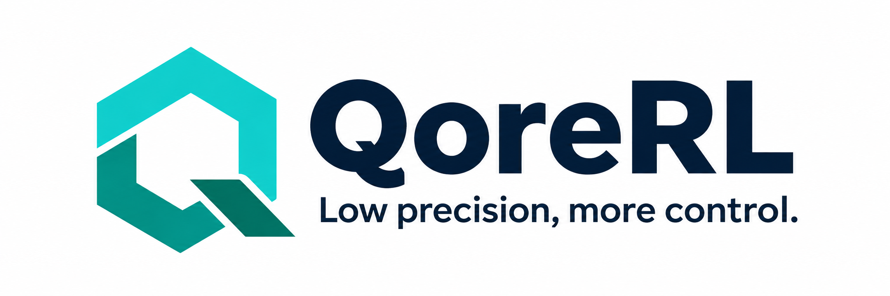
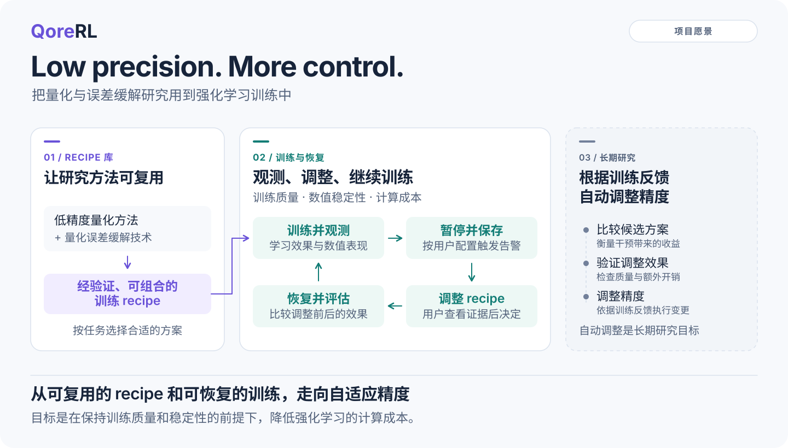

# QoreRL

[English](README.md) · **简体中文**

<picture>
  <source media="(prefers-color-scheme: dark)" srcset="docs/assets/qorerl-overview-dark.zh-CN.svg">
  
</picture>

QoreRL 是一个以量化为核心的大模型强化学习框架，目前处于早期开发阶段。它将低精度方法做成可复现的 **recipe**，让用户可以在实际训练中使用并比较这些方法。

首期聚焦可配置的精度 recipe、数值诊断和训练恢复。用户可以观测训练，在出现异常时保存可恢复的状态，根据证据选择如何调整，然后继续训练。根据训练反馈自动调整精度是长期研究目标。

> **当前实现。** 基于 Ray 的同步 GRPO 支持在选定层执行低精度计算（默认 MXFP8，也可选 NVFP4）、固定 Hadamard 旋转和实验性的动态 SmoothQuant。用户可以先发现 outlier、直接校准已知层，或导入已有的缩放因子。训练可以携带观测证据暂停，等用户接受或拒绝具体变更后恢复。这些流程已通过本地测试。原生 GPU 执行、训练质量和成本仍待验证。

第一份 recipe 指南给出了可直接对照的 BF16、MXFP8、MXFP8 + Hadamard 三组配置，以及适用算子、已知开销和 GPU 验证步骤。这些实现目前处于实验阶段。[固定 Hadamard 使用指南](docs/recipes/mxfp8-hadamard.zh-CN.md)

Recipe Insights 逐层展示每种方案的开销和数值效果。启用探针后，它使用训练端同一组输入和权重比较 BF16、MXFP8、MXFP8 + Hadamard。用户可以在本地实时看结果，检查具体层，并导出报告或图表。[使用方法和测量范围](docs/recipe-insights.zh-CN.md)

*此图使用合成数据演示界面。原生 GPU 数据及训练收益仍待验证。*

## Recipe 目录与路线图

下表涵盖已实现、计划引入和研究中的量化方法、误差缓解技术和 RL 修正方法。状态描述的是 **QoreRL 的集成进度**。最近一次评估为 **2026-11-18**。

- **已实现，待 GPU 验证**。实现和本地测试已完成，仍需验证原生 GPU 执行、学习效果和性能。
- **已通过 GPU 验证**。已在有记录的工作负载上验证原生执行和结果。目前尚无 recipe 达到此状态。
- **计划中**。已选定要实现的方法。
- **研究中**。仍需评估是否值得集成。

**当前重点**是在 GPU 上验证原生 recipe，对照同等条件下的基线，比较数值表现、奖励和总训练成本。

| Recipe 或技术 | 状态 | 目标 | 适用范围与来源 |
| --- | --- | --- | --- |
| **BF16 对照** | 已实现，待 GPU 验证 | 为学习质量、数值表现和成本提供相同条件下的参照 | 单 rank、稠密 Qwen3、Megatron + vLLM。[配置与指南](docs/recipes/mxfp8-hadamard.zh-CN.md) |
| **指定层使用 MXFP8 / NVFP4** | 已实现，待 GPU 验证 | 在训练与采样两端为选定的 MLP 下投影指定基础精度 | 默认 MXFP8。在兼容的环境中可通过 `recipe_options.precision` 选用 NVFP4，其余算子沿用 BF16。[MXFP8 指南](docs/recipes/mxfp8-hadamard.zh-CN.md) · [NVFP4 环境要求](docs/ray-grpo.zh-CN.md#原生-nvfp4-需要什么) |
| **固定 Hadamard + MXFP8 / NVFP4** | 已实现，待 GPU 验证 | 用固定的随机分块旋转把激活离群值分散到多个通道，对权重施加配套变换 | 当前实现覆盖 MLP 下投影，QuaRot 原文还包含其他位置的变换。[使用指南](docs/recipes/mxfp8-hadamard.zh-CN.md) · [QuaRot](https://arxiv.org/abs/2404.00456) |
| **可学习旋转与基于 Hadamard 的变换** | 计划中 | 通过学习选择更合适的旋转 | 标准 Hadamard 矩阵固定。[SpinQuant](https://arxiv.org/abs/2405.16406) 学习正交旋转，[HARP](https://arxiv.org/abs/2605.29843) 用 Hadamard 初始化结构化变换。两者从训练后量化迁移到 RL 都需要适配。 |
| **动态 SmoothQuant** | 已实现，待 GPU 验证 | 在用户固定的低精度层范围内添加或刷新通道缩放，与该层当前方案配对比较 | 作用于选定的 MLP 下投影，支持周期校准、保存检查点后审核，以及导入外部缩放因子。[运行流程](docs/recipes/dynamic-smoothquant.zh-CN.md) · [SmoothQuant 原文](https://arxiv.org/abs/2211.10438) |
| **Calibrated Clipping** | 计划中 | 校准 PPO 的裁剪边界，减少 FP8 概率比失真对有效更新的抑制 | 原文每 20 步对当前和旧策略各做一次 BF16 前向，结果用于校准裁剪边界。这两次前向不做梯度计算或参数更新。[威斯康星大学麦迪逊分校与字节 Seed 论文](https://arxiv.org/abs/2609.22870) |
| **TRIAGE 训推偏差修正** | 研究中 | 结合优势值和训推 log-prob 差异为轨迹片段重新加权，限制可能放大偏差的更新 | 面向原生 NVFP4 W4A4 训练与采样，需保留行为策略的 log-prob 并接入 loss。修正后的真实梯度方向仍需检验。[TRIAGE](https://arxiv.org/abs/2610.07043) |
| **FourSight 轨迹筛选** | 研究中 | 筛掉包含过多或连续出现低概率 token 的轨迹，概率由训练端评估 | FP4 RL 中的数据选择方法。需同时评估保留的数据量、采样成本及学习质量。[FourSight](https://arxiv.org/abs/2611.04887) |
| **FourSight 稀疏 BF16 补偿** | 研究中 | 主体计算使用 NVFP4，用稀疏 BF16 计算保留高方差激活通道的贡献 | FourSight 的数值计算部分使用 SpliceGEMM。可独立于轨迹筛选评估，需集成相应内核。[FourSight](https://arxiv.org/abs/2611.04887) |
| **QUADS 双端误差对齐** | 研究中 | 在训练端对权重做伪量化，在采样端补偿激活残差 | 面向 NVFP4 MoE RL，训练侧用 W4A16，采样侧用 W4A4 并增加 FP4 残差项。接入需要支持 MoE。[QUADS](https://arxiv.org/abs/2607.15810) |
| **Quaff 自适应离群通道缩放** | 研究中 | 利用离群通道位置相对稳定的特点，跟踪其幅值变化 | 论文在量化参数高效微调中使用基于动量的缩放。全参数 RL 场景仍需单独验证。[Quaff](https://arxiv.org/abs/2505.14742) |
| **Smooth-SwiGLU** | 研究中 | 对 SwiGLU 计算重新缩放并补偿，抑制 MLP 下投影前的离群值放大 | 原文研究的是长周期预训练，在 MXFP8 分块缩放和 RL 下的价值需另外测量。[Scaling FP8 training to trillion-token LLMs](https://arxiv.org/abs/2409.12517) |
| **Attention 输出门控** | 研究中 | 让 attention head 能直接减弱自己的更新，降低产生极大激活或 attention sink 的需求 | 增加可学习的门控，已有 checkpoint 需要结构适配和训练。[Quantizable Transformers](https://arxiv.org/abs/2306.12929) · [Gated Attention](https://arxiv.org/abs/2505.06708) |
| **Clipped softmax** | 研究中 | 允许注意力概率取零，使 head 可以不产生更新 | 论文中的另一项实验。它改变 attention 的语义和内核要求，作用位置与 PPO 的裁剪不同。[Quantizable Transformers](https://arxiv.org/abs/2306.12929) |
| **面向 sink 的归一化：PreAffine / GatedNorm** | 研究中 | 提供显式的缩放手段，减少模型依靠残差离群值调节归一化表示的需求 | 涉及归一化和架构调整。论文区分了 sink 的功能，应用时需考虑其作用。[A Unified View of Attention and Residual Sinks](https://arxiv.org/abs/2601.22966) |
| **HALO 前向与反向旋转** | 研究中 | 降低前向和反向矩阵乘法中由离群值引起的量化误差 | 原文在低精度微调中把变换用于多个位置，范围大于当前 MLP 下投影 recipe。需要适配 Megatron 和 RL。[HALO](https://arxiv.org/abs/2501.02625) |
| **Four Over Six 自适应 NVFP4 分块缩放** | 研究中 | 为每个块选择缩放，使最大值靠近 FP4 的 4 或 6，降低块最大值附近的量化误差 | 已有预训练和推理研究。作为量化器选项接入时，训练、导出和采样必须使用一致的缩放规则。[Four Over Six](https://arxiv.org/abs/2512.02010) |
| **Quartet II / MS-EDEN** | 研究中 | 用无偏的微缩放量化方法改善 NVFP4 梯度估计，提供随机舍入之外的选择 | 原文给出预训练结果和 Blackwell 内核。量化器的无偏性质本身不足以推导 RL 梯度无偏或训练收敛。[Quartet II](https://proceedings.mlr.press/v306/panferov26a.html) · [NVFP4 配方比较](https://arxiv.org/abs/2610.24343) |
| **可学习的 NVFP4 分块缩放** | 研究中 | 在校准后继续学习权重量化的 scale，可只更新 scale，也可与权重联合更新 | NVIDIA Model Optimizer 在 QAT/QAD 中支持分块权重 scale。RL 优化和权重导出、重载仍需验证。[NVIDIA scale learning](https://nvidia.github.io/Model-Optimizer/announcements/20260916-scale-learning.html) |
| **COAT 优化器状态与激活压缩** | 研究中 | 量化优化器状态和保存供反向使用的激活，减少训练显存占用 | 已有预训练和微调结果。接入需适配 Megatron 优化器、激活存储和检查点恢复。[COAT](https://arxiv.org/abs/2410.19313) |

改变前向策略的方法需要训练、权重导出和采样三端协同。仅用于反向传播的方法由训练端执行。架构变更、面向部署的量化和原生低精度训练各有不同的集成要求，组合效果也要单独验证。

Recipe Insights 是各 recipe 共用的测量工具。目前它会定期用 BF16 对照探测算子。Calibrated Clipping 和自动修复是另行评估的功能。项目将在给出使用建议前，补充相应工作负载上的质量、成本和兼容性证据。

## QoreRL 在做什么

### 1. 把研究方法做成可复现、可配置的 recipe

选取已有和新发表的研究，复现其中的方法，提供独立选项和经过测试的组合。一份 **precision recipe** 描述哪些计算使用什么精度或数值方法，以及配套的变换和执行条件。

每种方法或 recipe 都应记录以下内容。

- **作用范围**。前向（Fprop）、激活梯度（Dgrad）、权重梯度（Wgrad）、权重导出、采样或配套的 RL 修正。
- **证据**。论文或参考实现、可复现的配置、测试过的模型和工作负载，以及结果来自模拟还是原生内核。
- **兼容性**。硬件、引擎版本、已测试的组合以及冲突配置。
- **取舍**。训练质量、数值表现、显存和端到端成本。

实验方案与通过指定工作负载验收的 recipe 应有明确标识。两种方法单独有效，组合后还需再做验证。遇到不支持的组合，应在配置校验时报告，避免静默切换执行方式。

### 2. 诊断数值问题，让用户带着证据恢复训练

出现异常时，框架帮助用户了解发生了什么，保留已经完成的训练进度，并尝试支持的调整。

观测对象包括非有限值、量化统计、梯度表现、训推概率偏差和训练质量趋势。报告应分别给出**测到的现象、可能的原因和候选操作**。单独一个 outlier 或一次梯度余弦为负，还不足以判定训练失败或某项调整有益。

暂停规则应显式可配。确定无效的状态可以阻止一次优化器更新，证据较弱的信号可以触发告警或追加观测。需要暂停时，在安全边界保留诊断材料。

- **恢复检查点**保存一个通过既定检查的边界处的完整训练状态，包括模型和优化器、调度器和进度、随机数和数据状态，以及当前 recipe 和内部状态。
- **异常记录**保存异常时的观测结果，必要时也保存张量或状态快照。续训使用先前完整的恢复检查点。

首期恢复流程允许用户调整配置，再从兼容检查点重启。框架验证变更、重建引擎所需状态，并记录新的 recipe 版本。影响前向策略的变化需要协调训练与采样两端。最初的恢复设计是在有待处理的旧采样数据时丢弃它，并重新采样。仅涉及反向传播的配置保留在训练端。

### 3. 持续研究自动适应

在可用的训练流程上，持续研究敏感度分析、局部高精度、通道缩放、旋转及其他数值干预。

从**人工选择如何调整**起步，再发展到**比较候选并向用户提供建议**，最终探索**在明确验证过的条件和成本预算内自动调整**。每次调整都应保留触发它的观测证据、配置变化和实际结果，让手工实验也能为后续自动化提供依据。

每种干预都有待测量的代价与收益。即使自动选择规则尚未建立，单独复现和评估一种方法也有价值。

## 为什么做 QoreRL？

低精度有机会节省显存和计算成本，实际收益取决于量化用在哪里、误差如何在训练中传播。出现很大的激活值，并不一定意味着该层对量化敏感。降低张量误差后，也需要检查学习效果。

开发者常常需要回答这些具体问题。

- 一篇论文中的低精度方法，能在我的训练栈上复现吗？
- 哪些方法可以组合使用？有哪些证据？
- 训练出现异常时，已经知道什么？我能改什么？
- 能否保留训练进度，调整 recipe 后可靠续训？
- 把观测和恢复的开销也算进去，新配置能否改善质量或成本？

QoreRL 希望让这些实验可复现、可控制，并逐步积累支持自动决策的证据。

## 怎样使用校准流程

先确定低精度层。例如把 `recipe_options.layers` 设为 `[7, 15, 20, 25]`，把 `smoothquant_layers` 设为 `[7, 15, 20]`。从第一批开始，四层的下投影都执行 MXFP8。如果开启 `allow_layer_expansion: true`，第 25 层可以在通过校准和批准后叠加 SmoothQuant。名单外各层继续用 BF16。用户也可以直接校准已知目标层，或在首次采样前导入已有的缩放因子。

周期校准时，训练端在同一批留出的激活行上比较当前方案和候选方案的误差。人工审核模式下，训练保存提案和检查点后退出。用户接受时，learner 和各 rollout 副本同步新的缩放因子。拒绝则沿用现行方案继续。预先授权自动批准时，仍然使用相同的证据、检查点和发布流程。[CPU 演练与原生配置](docs/recipes/dynamic-smoothquant.zh-CN.md)

两端配置一致后，还需要在实际引擎上验证数值是否一致，包括相关的组批方式、prefill 和 decode。每条轨迹都应记录生成它的权重版本和 recipe 版本。

切换 recipe 从后续计算开始生效。要撤回已经发生的优化器更新，需要恢复更早的检查点。换用不同 recipe 后续训，属于从同一状态出发的另一条实验路径。

## 评估原则

- **衡量学习效果。** 除了张量误差，还要看算子输出、梯度表现和端到端训练质量。
- **区分证据与假设。** 告警提供异常线索。梯度更接近 BF16 之后，仍需测量实际学习效果。
- **直接检查训推偏差。** 用相同输入和模型快照对比 log-prob，检查非有限值和尾部误差。
- **验证组合效果。** 多项调整同时启用时会相互影响。
- **覆盖真实执行路径。** 模拟量化用于初筛，最终验收应覆盖实际内核和目标精度的计算方式。
- **计算完整成本。** 计入观测、候选评估、数值变换、同步、检查点和恢复的开销，以及显存和达到指定质量所花的实际时间。
- **验证恢复本身。** 在兼容的配置变更后，检查从检查点恢复的运行是否采用预期的数值路径。
- **保留基线和回退方案。** 通过基线确认收益，尤其是在一种变换仅体现出 outlier 变小时。

多个观测批次可以扩大覆盖范围，仍可能遗漏未来工作负载。筛选候选和决定是否接受应使用不同的观测数据。配对比较数值时使用相同的模型快照和 token 序列，以便区分执行方式与策略本身变化的影响。

## 初始范围与路线图

首个原生组合是 **Megatron Core / Transformer Engine + vLLM**，目标模型为单 rank 的稠密 Qwen3。原生默认 recipe 在选定的 MLP 下投影上直接使用 MXFP8。将 `recipe_id` 设为 `bf16-baseline-v1` 可运行 BF16 对照。要尝试实验性的 NVFP4，在 `mlp-down-v1`、`hadamard-mlp-down-v1` 或 `smoothquant-mlp-down-v1` 中将 `recipe_options.precision` 设为 `nvfp4`。两种格式都在等待原生 GPU 验证。原生 MoE、模型并行训练、**SGLang** 和更多模型属于后续工作。

QoreRL 复用现有训练与推理基础设施，首期工程集中在精度配置、证据收集和跨引擎恢复，底层计算与分布式调度交给已有引擎。

### 首个里程碑：训练可运行、可观测、可恢复

- [x] 实现基于 Ray 的 GRPO 训练循环，记录轨迹版本并等待权重发布确认。
- [x] 实现 Megatron/vLLM 适配和明确用于 CPU 集成测试的引擎。
- [x] 在本地验证分组、loss 归一化、优化器更新，以及相同配置下的检查点与续训。
- [ ] 在 GPU 上验证原生 BF16，包括训推 log-prob 和 refit。
- [ ] 建立原生 MXFP8 训推基线，测量质量和成本。
- [x] 实现 MLP 下投影的实验性 MXFP8 recipe，提供可选的固定 Hadamard 及配套对照配置。
- [x] 记录 recipe 标识与变换状态，拒绝不兼容的 refit 和检查点恢复。
- [x] 实现可选的逐层配对探针、本地实时对照界面，以及独立报告和图表导出。GPU 测量仍待完成。
- [ ] 将选定的研究方法整理为有文档的选项和经过验证的 recipe。
- [ ] 完成原生训推配对检查，包括尾部误差和 refit 后的行为。
- [ ] 增加数值诊断、可配置的告警与暂停规则，以及异常报告。
- [x] 支持接受或拒绝限定范围的 SmoothQuant 提案后继续训练。
- [ ] 将兼容配置变更和恢复流程扩展至更多 recipe。
- [ ] 发布可复现的比较和恢复案例，记录调整未带来改善的情况。

### 持续研究与后续自动化

- [ ] 在原生内核上验证替换 Wgrad 激活的干预方案，包括显存和执行成本。
- [ ] 研究选择性缩放、旋转、精度切换及其组合。
- [ ] 在有代表性的 RL 工作负载上评估敏感度探针和候选比较方法。
- [ ] 根据实测证据推荐调整，并在启用前取得用户批准。
- [ ] 在已验证的范围内自动调整，跟踪变更后的表现并支持恢复。

这些研究与首期开发并行推进。首期交付聚焦可用的实验和恢复流程。

## 开发

项目同步推进两项工作：开发可用的 recipe、诊断与恢复流程，以及开展受控数值实验。可运行 `uv run ruff check qorerl tests` 和 `uv run pytest -q` 进行验证。

仓库文档默认使用英文，项目首页、设计和核心指南也提供简体中文，可在各页顶部切换。[设计原则](design.zh-CN.md) · [开发计划（英文）](todo.md) · [开发指南](docs/ray-grpo.zh-CN.md)

欢迎通过 GitHub Issues 讨论设计、提出实验方案。[GitHub Issues](https://github.com/wengeezhang/QoreRL/issues)
