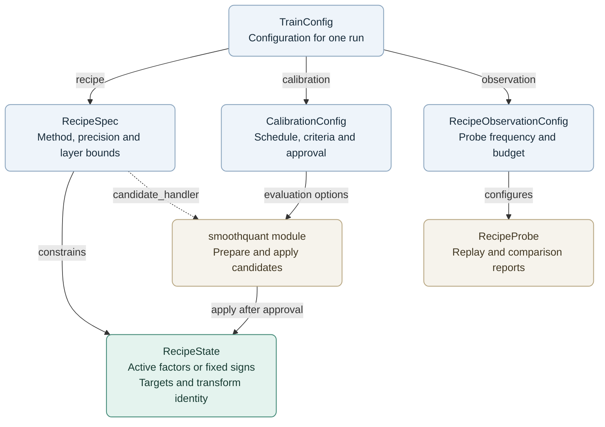
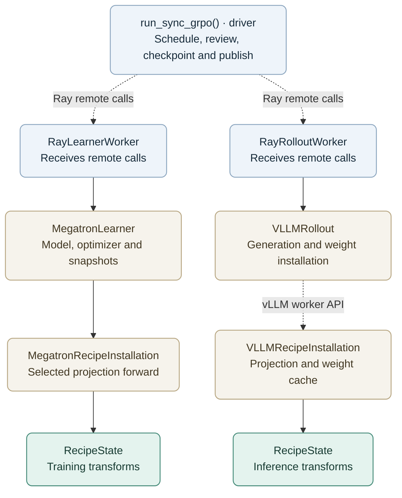
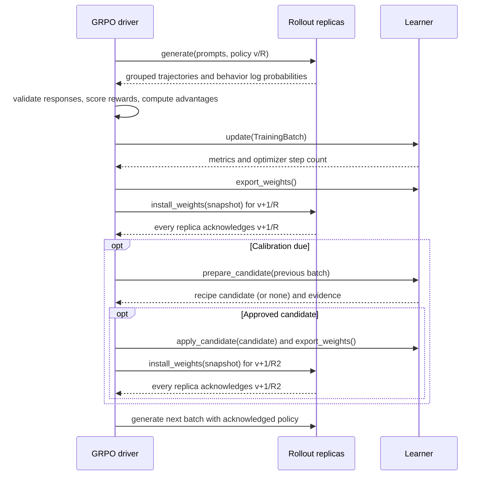
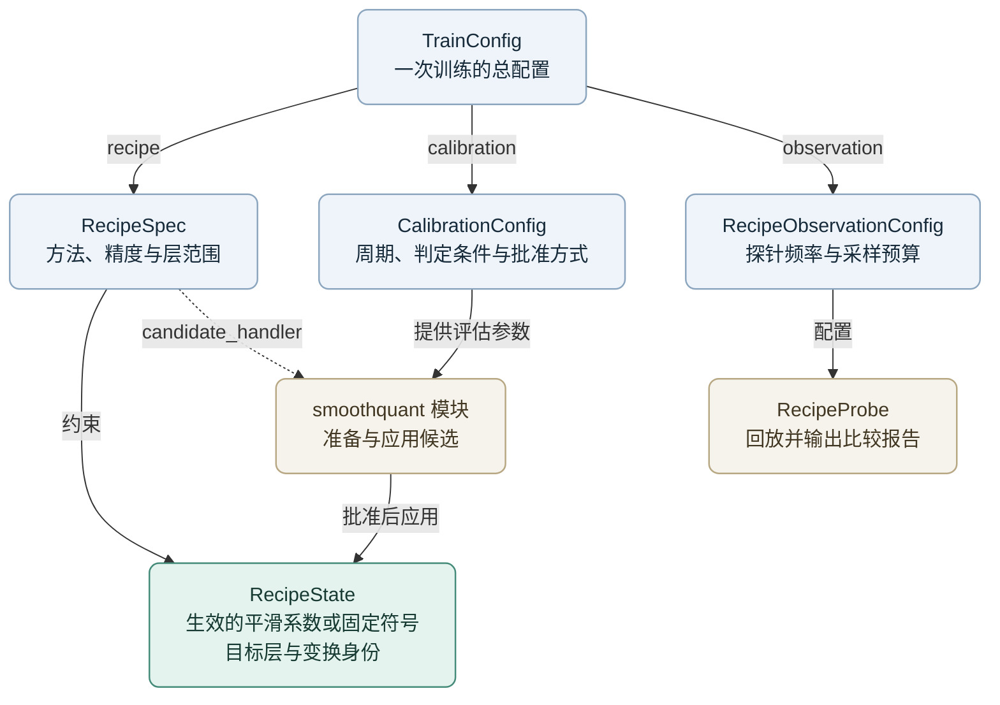
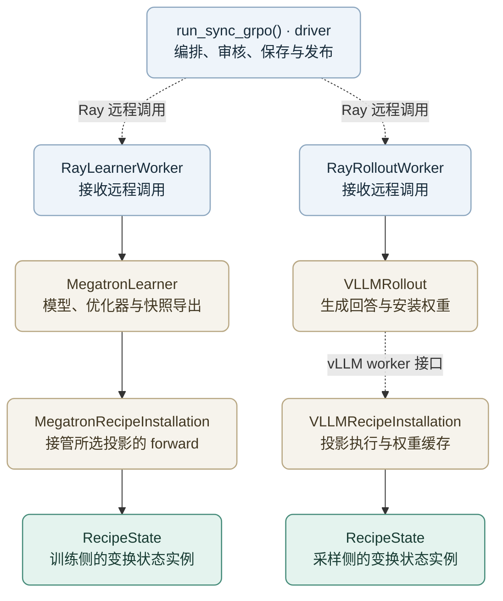

# QoreRL code walkthrough · 架构实现解读

**English** · [跳到中文版](#zh-cn) · [Design and architecture](design.md)

<a id="english"></a>

QoreRL runs synchronous GRPO with a precision recipe shared by a learner and its rollout replicas. Start with the two maps below: **what describes a recipe and its active state**, then **which component schedules, owns and executes the work**. The remaining sections follow a sampled response from rollout to the optimizer and a weight snapshot back to every rollout replica.

[Configuration and state](#configuration-map) · [Execution responsibilities](#execution-map) · [Training and publication sequence](#trace) · [CPU review example](#cpu-run)

<a id="configuration-map"></a>

## 1. Configuration and active recipe state

**`RecipeSpec` describes the chosen method and its boundaries. `RecipeState` stores the transforms that are active now.** The diagram shows configuration and state relationships; arrows are labeled by their role, rather than implying that every box is a class or every arrow is a method call.



| Object | Responsibility | Where to read |
| --- | --- | --- |
| `TrainConfig` | Resolves the recipe, calibration and observation settings, and validates their combination with the engines. | [Training configuration](qorerl/training/config.py) |
| `RecipeSpec` | Immutable method, precision, low-precision layer scope, initial transform scope and expansion permission. Selects the optional candidate handler. | [Recipe specification](qorerl/recipes/spec.py) |
| `RecipeState` | Registered targets, fixed Hadamard signs or active SmoothQuant smoothing factors, and the resulting identity. Serializes transform state for publication and recovery. | [Runtime state](qorerl/recipes/state.py) |
| `CalibrationConfig` | When to evaluate, how much input to collect, discovery and acceptance criteria, and manual or automatic approval. The driver uses the schedule and approval settings; the recipe uses the fitting and evaluation settings. | [Calibration configuration](qorerl/recipes/calibration.py) |
| `RecipeObservationConfig` / `RecipeProbe` | Configure and execute Recipe Insights comparisons. The probe writes measurements; it does not install candidates. | [Probe configuration](qorerl/observability/config.py) · [Probe](qorerl/observability/probe.py) |

For example, the spec can select low-precision layers `[7, 15, 20, 25]`, enable SmoothQuant initially on `[7, 15, 20]`, and permit expansion. A later approved candidate adds smoothing factors for layer 25 to the **state**. The **spec** stays unchanged: layer 25 was already inside the permitted low-precision scope. Layer 23 remains outside it.

`candidate_handler` is an optional module interface, currently implemented by **SmoothQuant**. Its preparation returns a proposal and evidence without changing the active state. After approval, the learner calls its application function. **Fixed Hadamard intentionally has no candidate handler**: `RecipeState.add_target()` creates its signs from the configured seed and layer index, and `PreparedHadamard` executes the fixed rotation. It does not run periodic sign search or learn the rotation. [Candidate dispatch](qorerl/recipes/spec.py#L49) · [SmoothQuant handler](qorerl/recipes/smoothquant.py#L251) · [Hadamard execution](qorerl/recipes/hadamard.py)

The observation branch is separate from candidate calibration. Recipe Insights currently compares supported fixed MXFP8 methods. SmoothQuant uses the calibration path for evidence and proposals. Its viewer now reads those existing calibration events directly, with one comparison window at a time and explicit links to earlier manual-review runs. [Calibration view](docs/recipe-insights.md#smoothquant-reuse-calibration-evidence) · [GPU smoke audit](docs/gpu-validation.md). `RecipeState` holds transform data and small transform caches; model parameters and optimizer state belong to the learner, and rollout's packed weight cache belongs to its installation.

<a id="execution-map"></a>

## 2. From orchestration to numerical execution

Read down each column: **schedule work → receive remote calls → execute the model → adapt selected projections → read transform state**. Solid arrows denote object ownership. Dashed arrows denote calls through a worker API. This is the native Megatron/vLLM path; only one rollout replica is drawn.



The driver is a **function**, and the SmoothQuant handler above is a **module**. `LearnerEngine` and `RolloutEngine` are **protocols** describing the methods the workers can call. The concrete `MegatronLearner` inherits the shared optimizer and candidate-dispatch logic from `SingleRankGRPOLearner`. The diagram follows runtime ownership, not class inheritance. [Driver](qorerl/runtime/ray_runtime.py#L33) · [Ray wrappers](qorerl/runtime/ray_workers.py) · [Protocols](qorerl/engines/base.py) · [Shared learner](qorerl/engines/single_rank_learner.py#L77)

There are two worker layers on the rollout side. QoreRL's `RayRolloutWorker` holds the `VLLMRollout` engine. The executable inference model and its `VLLMRecipeInstallation` live inside vLLM's `QoreRLRecipeWorker`. The engine reaches that installation through vLLM's worker API; the dashed edge to the installation abbreviates this internal boundary. [vLLM engine](qorerl/engines/vllm.py#L54) · [Inner worker](qorerl/engines/vllm_worker.py#L17)

**The two `RecipeState` boxes are separate instances.** A `WeightSnapshot` transports canonical weights and serialized recipe state through the driver's publication barrier. Each rollout installation validates and installs the state, rebuilds its derived weights, and acknowledges the version. The learner also exposes its installation's state through `recipe_state`; that reference is an alias within the learner. [Learner installation](qorerl/engines/megatron.py) · [Rollout installation](qorerl/recipes/vllm_mxfp8.py#L193)

The objects crossing these boundaries have different jobs:

| Data object | Route and meaning |
| --- | --- |
| `Prompt` | Driver → rollout: one task's token IDs, group ID and reference answer. |
| `Trajectory` | Rollout → driver: one sampled response, behavior log probabilities and the policy that generated it. |
| `TrainingBatch` | Driver → learner: ordered trajectories, rewards, advantages and their policy version. |
| `PaddedMicrobatch` | Within the learner: device tensors with causal labels, response masks and loss inputs. |
| `WeightSnapshot` | Learner → every rollout replica: canonical weights, model identity, policy version and serialized recipe state. |
| `PolicyVersion` | Associates samples and publications with both a weight version and an active recipe identity. |

[Data contracts](qorerl/training/contracts.py) · [Microbatch construction](qorerl/training/batching.py)

## 3. From the command line to the first rollout

`qorerl train --config … --out …` enters `qorerl.cli.main()`. It loads a `TrainConfig` and calls `run_sync_grpo()`. The config resolves the recipe name, base precision, selected projections and calibration options. On the native path the driver resolves the model revision before starting either engine. Look here first if a run uses unexpected defaults. [CLI](qorerl/cli.py#L8) · [Training configuration](qorerl/training/config.py) · [Recipe resolution](qorerl/recipes/spec.py#L127)

The driver creates one `RayLearnerWorker` and a configured number of `RayRolloutWorker` instances. Each worker owns a long-lived engine created by the backend factory. On the native path the learner owns Megatron and each rollout worker owns vLLM. The CPU example selects `torch_test` on both sides and exercises the same Ray remote calls. At startup the driver publishes the initial policy and waits for installation acknowledgements before handing out prompts. [Driver](qorerl/runtime/ray_runtime.py#L34) · [Worker wrappers](qorerl/runtime/ray_workers.py) · [Factory](qorerl/engines/factory.py) · [Engine interfaces](qorerl/engines/base.py)

`WorkerPlacement` determines where these processes run. The default `separate` mode assigns each worker its own GPU; `collocate` puts one learner and one rollout worker in the same placement bundle on one GPU. They keep their own engines and memory, and the synchronous driver alternates their work. The learner finishes loading or restoring before vLLM profiles memory. This physical placement does not change the ownership shown above or the recipe approval/publication flow. [Placement code](qorerl/runtime/placement.py) · [Single-GPU configuration and memory budget](docs/ray-grpo.md#single-gpu-collocation)

<a id="trace"></a>

The diagram starts after the initial publication. `v` is the batch's weight version, `R` the active recipe identity, and `R2` its identity after an approved recipe change.



In manual mode the gap between proposal and approval can span two invocations of the CLI. The checkpoint joins the two halves. [Calibration and review in the driver](qorerl/runtime/ray_runtime.py#L231)

## 4. Follow one response into the optimizer

| Stage | What happens to one response | Code to open |
| --- | --- | --- |
| Sample | The driver assigns a whole prompt group to one replica. vLLM draws `group_size` answers and returns a `Trajectory` per answer with the prompt IDs, generated token IDs, one behavior log probability per generated token, and the policy version. | [Dispatch](qorerl/runtime/ray_runtime.py#L178) · [vLLM generation](qorerl/engines/vllm.py#L106) |
| Assemble | The driver verifies the prompt, version and unique `(group_id, sample_id)` for every answer, then restores group order. The built-in task scores exact matches. Each answer gets its reward minus the group mean, divided by the group population standard deviation plus `1e-6`. The driver sends trajectories, rewards, advantages and version together as a `TrainingBatch`. | [Validation and data types](qorerl/training/contracts.py#L38) · [Tasks](qorerl/training/tasks.py) · [Advantages](qorerl/training/objective.py#L11) |
| Score the sampled tokens | The learner replays the prompt and the recorded response. The logit at the final prompt position scores the first generated token. Only generated tokens contribute to the loss, including EOS when sampled. The denominator of the PPO ratio comes from the stored behavior log probability of that **same token**. | [Causal shift and masks](qorerl/training/batching.py) · [GRPO loss](qorerl/training/objective.py#L25) |
| Update | Each response contributes its mean clipped policy loss. A microbatch of two responses in a batch of eight contributes `2/8` of its mean loss before backpropagation. Gradients accumulate on FP32 master parameters. The learner clips the gradients, calls AdamW once per active update epoch and copies updated parameters back into the model. | [Learner update loop](qorerl/engines/single_rank_learner.py#L166) |

Two counters explain the scheduling. **Weight version** advances once per consumed batch. **Optimizer steps** counts actual AdamW calls. An all-zero-advantage batch advances the version and skips AdamW. A batch with multiple active update epochs can advance the optimizer counter several times. The driver checks whether that counter crossed a calibration interval at the batch boundary. [Version contract](qorerl/training/contracts.py#L15) · [Interval check](qorerl/runtime/calibration.py#L66)

## 5. Follow one projection from Megatron to vLLM

Take decoder layer 25 in the supplied Qwen3 configuration. Megatron calls its MLP down projection `decoder.layers[25].mlp.linear_fc2`. The name that travels between engines is `model.layers.25.mlp.down_proj.weight`. The same canonical parameter serves training, export and recovery. [Example configuration](configs/grpo_dynamic_smoothquant.json) · [Megatron installation](qorerl/recipes/megatron_mxfp8.py#L57) · [Bridge export](qorerl/engines/megatron.py#L99)

1. **Execute on the learner.** Installation replaces the selected module instance's forward method. For a weight shaped `[out, in]`, direct low precision packs the input `X` and weight `W`. Fixed Hadamard first transforms both along the input channels with the same orthogonal transform. SmoothQuant divides each input channel by its smoothing factor and multiplies the matching weight column by that factor. The backend quantizer then computes block scales for the transformed operands. In exact arithmetic each pair preserves `X @ W.T`. The native autograd function saves the packed operands. Its backward packs the incoming output gradient and uses the saved operands to compute input and weight gradients. Autograd carries those gradients back through the transforms to the original coordinates. [Projection forward](qorerl/recipes/megatron_mxfp8.py#L26) · [Transforms](qorerl/recipes/state.py#L164) · [Forward and backward GEMMs](qorerl/recipes/te_block_linear.py#L139)
2. **Publish the trained policy.** Megatron Bridge exports HF-named weights to a CPU tensor mapping. A `WeightSnapshot` carries those canonical weights, model identity, policy version and recipe state. Fixed Hadamard state includes the signs. SmoothQuant state includes the active per-channel smoothing factors. The driver passes the Ray reference returned by `export_weights.remote()` to every replica, so the driver does not materialize the full weights during publication. [Snapshot](qorerl/training/contracts.py#L65) · [Export](qorerl/engines/megatron.py#L99) · [Publication barrier](qorerl/runtime/ray_runtime.py#L112)
3. **Install inside the inference process.** The rollout adapter calls the worker extension inside vLLM, where the executable model lives. It loads canonical weights, checks parameter coverage, installs the recipe state, rebuilds transformed and packed weights, and synchronizes CUDA. Future decode calls reuse the packed weights and transform each new activation. The outer worker returns the installed policy version. The next batch waits for matching acknowledgements from every replica. This establishes which state each engine installed. Agreement of output probabilities is a separate numerical measurement. [vLLM setup](qorerl/engines/vllm_worker.py#L17) · [Refit and acknowledgement](qorerl/engines/vllm.py#L9) · [Cache rebuild](qorerl/recipes/vllm_mxfp8.py#L217)

The native learner calls NVIDIA Transformer Engine for both MXFP8 and NVFP4. On the rollout side MXFP8 uses vLLM’s FlashInfer CUTLASS linear kernel and CuTe-DSL quantizer. NVFP4 uses the Transformer Engine packer and forward GEMM. [Learner backend selection](qorerl/recipes/te_block_linear.py#L35) · [Rollout backends](qorerl/recipes/vllm_mxfp8.py#L23)

**Cache ownership matters here.** Rollout already reuses transformed and packed weights after publication. Training currently transforms and quantizes weights on each projection forward. Reusing those representations across microbatches within one optimizer step is recorded in the [roadmap](todo.md); it is not implemented. Smoothing factors and Hadamard signs cached in `RecipeState` do not provide that weight cache.

## 6. What changes when a recipe can adapt?

In the example, layers **7, 15, 20 and 25** start with MXFP8 down projections. Layers **7, 15 and 20** also start with SmoothQuant. Layer 25 is eligible to gain that transform. Layer 23 stays outside this recipe's low-precision scope throughout the run. `RecipeSpec` defines these scopes. `RecipeState` holds the transforms currently installed. [Scope selection](qorerl/recipes/spec.py#L92) · [Installed state](qorerl/recipes/state.py#L61)

`SingleRankGRPOLearner.prepare_candidate(batch)` collects the inputs. For a periodic SmoothQuant proposal, `RecipeSpec.candidate_handler` selects the SmoothQuant module. Its `prepare_candidate` calls `prepare_smoothquant_candidate` to fit and evaluate the factors and returns a serialized artifact with the evidence. The driver can checkpoint and review that artifact for any supported recipe. On acceptance, the learner’s `apply_candidate(artifact)` delegates to the same module. `parse_smoothing_artifact` verifies the artifact and `apply_smoothquant_candidate` merges its factors into the installed state. Startup import uses `initial=True` to limit installation to the configured initial layers. [Recipe dispatch](qorerl/recipes/spec.py#L49) · [SmoothQuant handler](qorerl/recipes/smoothquant.py#L251) · [Review record](qorerl/runtime/calibration.py#L9)

- **Collect.** After regular weight publication, a due calibration replays distinct token prefixes from the just-consumed batch under the updated learner. It captures input rows before applying the projection transform and excludes padding and duplicate prefixes. The event records both the policy that generated the tokens and the policy used for evaluation. [Prefix replay](qorerl/engines/single_rank_learner.py#L28) · [Calibration entry](qorerl/engines/single_rank_learner.py#L132)
- **Compare.** On fit rows the implementation takes the maximum absolute activation per input channel. The outlier score divides the largest of these maxima by their mean. For a selected layer, in channels with nonzero activation and weight maxima, the smoothing factor is `activation_max**alpha / weight_max**(1-alpha)`. On held-out rows it compares the current and proposed projection outputs against the same local BF16 result. For an active layer the baseline is its current factors. First activation on layer 25 is compared with direct MXFP8, requires an outlier, and can have an additional error ceiling. A candidate must improve the measured error and satisfy the configured minimum gain. Discovery-only runs return the outlier evidence with a null candidate. [Shared outlier scoring](qorerl/recipes/calibration.py#L64) · [SmoothQuant fitting](qorerl/recipes/smoothquant.py#L91) · [Candidate decision](qorerl/recipes/smoothquant.py#L128)
- **Decide and publish.** With a qualifying candidate, the driver saves a checkpoint before changing the active factors. Manual approval exits with `awaiting_review`. Resume restores and republishes the saved policy, checks the review ID and passes the accepted artifact back to the learner. Automatic approval performs the change in the same run. Installing new factors changes the transform digest in `recipe_id`, so the next batch can identify its exact recipe even if `weight_version` stayed at 1. A rejected or unqualified change leaves the existing factors active. [Decision and resume](qorerl/runtime/ray_runtime.py#L126) · [Transform identity](qorerl/recipes/state.py#L87) · [Review integrity](qorerl/runtime/calibration.py)

A user with known targets can bypass outlier screening for refreshes on active layers and go directly to fitting and comparison. First activation on a new layer still requires an outlier. Set `recipe_calibration.initial_artifact` to import compatible offline smoothing factors before the initial publication. A zero refresh interval keeps them fixed. [Calibration options](qorerl/recipes/calibration.py#L11) · [Startup application](qorerl/recipes/smoothquant.py#L269)

**Recipe Insights** has a different measurement point. Its optional native MXFP8 probe captures canonical inputs and weights in the first microbatch, then replays BF16, direct MXFP8 and fixed Hadamard MXFP8 before the optimizer changes the weights. It writes per-projection errors and timings to `recipe_metrics.jsonl` for `qorerl inspect` and `qorerl report`. Calibration runs after the regular publication and can propose a version change. Both measurements describe the tested projection on sampled inputs. Training reward, convergence and end-to-end speed require their own experiments. [Probe implementation](qorerl/observability/probe.py#L138) · [Reading the measurements](docs/recipe-insights.md)

<a id="cpu-run"></a>

## 7. Trace an actual review on CPU

From the repository root, the following config runs one learner and two rollout replicas. Use fresh output directories. The first command prints the checkpoint path and candidate ID used by the second command. [CPU config](configs/grpo_cpu_smoothquant.json) · [CPU engines](qorerl/engines/torch_test.py) · [Workflow tests](tests/test_calibration_workflow.py)

```sh
uv run --frozen qorerl train --config configs/grpo_cpu_smoothquant.json --out runs/review
# Replace CHECKPOINT and CANDIDATE_ID with the two values printed above.
uv run --frozen qorerl train --config configs/grpo_cpu_smoothquant.json \
  --out runs/accepted --resume CHECKPOINT --accept-candidate CANDIDATE_ID
```

In the checked CPU run, batch 1 produced 32 responses (4 prompts × 8). Layer 0 passed the outlier check and its held-out relative L2 error fell from **7.82% to 4.79%**. Layer 1 also passed discovery, but its proposed factors raised error from **3.31% to 3.86%**, so only layer 0 reached review. Layer 2 fell below the discovery threshold. All three CPU fixture layers had SmoothQuant enabled at startup, so this example tests a **refresh**. The layer-25 native configuration above illustrates **first activation**. The held-out rows can share a response with the fit rows. These numbers characterize the CPU fixture and this local projection comparison. [CPU experiment and error definition](docs/recipes/dynamic-smoothquant.md)

After accepting the proposal, the first event in the resumed run was `applied`. The weight version was still 1 and the smoothing factor digest had changed. **All 32 trajectories in batch 2 carried that new policy identity.** Training completed batch 3. This checks the link between a recorded decision and the samples produced after it.

| Question | Evidence to inspect |
| --- | --- |
| Which policy produced a response, and how did the update go? | `trajectories.jsonl` carries the sampled version, token IDs and behavior log probabilities. `metrics.jsonl` carries group and optimizer metrics. `pre_update_*` compares probabilities before the first update on this batch. |
| Why did training pause? | `calibration.jsonl` records per-target outcomes. `summary.json` gives the status, checkpoint and candidate ID. `candidate.json` in that checkpoint stores the recipe artifact in `candidate` and the measurements in `evidence`. |
| What survives a restart or a failed install? | `learner.pt` stores model, FP32 masters, optimizer, recipe state and Torch RNG state. `metadata.json` identifies the config, policy and pending candidate. The writer exposes the checkpoint directory after its files are complete. On a guarded runtime failure, `incident.json` points to the latest complete recovery point. A failed publication stops the run before another batch starts. |

To extend the code, start from the ownership of the change. A new numerical method touches recipe specification/state, the learner operator and the rollout installation. A new task supplies prompts and rewards in `training/tasks.py` and needs wiring in the driver. A new engine implements the learner or rollout interface, registers with the factory and needs config support. The present native path targets single-rank dense Qwen3 with Megatron and vLLM. The CPU run exercises training, review, publication and recovery with test engines. Native MXFP8/NVFP4 numerical parity, performance and training quality remain GPU validation work. [Checkpoint writer](qorerl/runtime/checkpoint.py#L19) · [Factory](qorerl/engines/factory.py) · [Project validation status](README.md)

<a id="zh-cn"></a>

## 中文解读 · 架构对象与训练调用链

先看两张图：**哪些对象描述 recipe 与当前状态**，以及**谁编排、谁持有、谁执行**。然后沿着两个方向追代码：一条回答从 rollout 进入优化器；一份权重快照从 learner 发布到每个 rollout 副本。训练期间更换 SmoothQuant 的平滑系数，也要走同一条发布链路。

[配置与状态关系](#configuration-map-zh) · [执行职责关系](#execution-map-zh) · [训练与发布时序](#trace) · [设计文档](design.zh-CN.md)

<a id="configuration-map-zh"></a>

### 1. 配置描述什么，运行状态保存什么？

**`RecipeSpec` 定义选了什么方法，以及允许在哪个范围内运行；`RecipeState` 保存此刻真正生效的变换。** 下图是配置与状态的关系图，箭头上的文字表示具体关系；不是每个框都是类，也不是每条箭头都是一次方法调用。



| 对象 | 负责回答的问题 | 对应代码 |
| --- | --- | --- |
| `TrainConfig` | 一次训练如何配置？解析 recipe、校准和观测配置，并检查它们与引擎的组合是否合法。 | [训练配置](qorerl/training/config.py) |
| `RecipeSpec` | 选什么方法、什么精度、哪些低精度层、哪些初始变换层，是否允许扩展？规格不可变，并选择可选的候选处理模块。 | [Recipe 规格](qorerl/recipes/spec.py) |
| `RecipeState` | 此刻哪些层注册了，固定 Hadamard 的符号是什么，SmoothQuant 的平滑系数是什么，对应哪个身份？负责变换状态的序列化与恢复。 | [运行状态](qorerl/recipes/state.py) |
| `CalibrationConfig` | 多久评估、采多少输入、怎样筛选与验收、谁批准？Driver 使用周期与批准配置，recipe 使用拟合与评估参数。 | [校准配置](qorerl/recipes/calibration.py) |
| `RecipeObservationConfig` / `RecipeProbe` | 如何配置并执行 Recipe Insights 的对比观测？探针产出测量结果，不负责安装候选。 | [探针配置](qorerl/observability/config.py) · [探针实现](qorerl/observability/probe.py) |

例如，spec 指定 `[7, 15, 20, 25]` 使用低精度，初始只在 `[7, 15, 20]` 叠加 SmoothQuant，并允许扩展。候选获批后，第 25 层的平滑系数进入 **state**。**Spec 不变**，因为第 25 层本来就在授权的低精度范围内；第 23 层始终不在其中。

`candidate_handler` 是可选的模块接口，目前由 **SmoothQuant** 实现。准备阶段返回提案和证据，不修改生效状态；批准后，learner 再调用应用入口。**固定 Hadamard 有意不提供候选处理模块**：`RecipeState.add_target()` 根据 seed 与层号生成固定符号，`PreparedHadamard` 执行旋转。它不会周期性搜索符号，也不学习旋转参数。[选择处理模块](qorerl/recipes/spec.py#L49) · [SmoothQuant 处理模块](qorerl/recipes/smoothquant.py#L251) · [Hadamard 执行](qorerl/recipes/hadamard.py)

图中的观测分支与候选校准是分开的。目前 Recipe Insights 对比支持的固定 MXFP8 方法，SmoothQuant 则通过校准链路生成证据与候选。`RecipeState` 保存变换数据和少量变换缓存；模型参数、优化器状态由 learner 管理，rollout 的打包权重缓存由其 installation 管理。

<a id="execution-map-zh"></a>

### 2. 从编排到计算，谁负责哪一层？

沿每一列向下读：**安排工作 → 接收远程调用 → 执行模型 → 接入所选投影 → 读取变换状态**。实线表示对象持有关系，虚线表示经过 worker 接口的调用。这里展示原生 Megatron/vLLM 路径，只画一个 rollout 副本。



Driver 是一个**函数**，上图的 SmoothQuant handler 是一个**模块**。`LearnerEngine` 和 `RolloutEngine` 是约定 worker 能调用哪些方法的 **Protocol**；具体的 `MegatronLearner` 则继承 `SingleRankGRPOLearner`，复用优化器和候选分派逻辑。这张图表达运行时的持有与调用关系，类继承另有其作用。[编排入口](qorerl/runtime/ray_runtime.py#L33) · [Ray 包装层](qorerl/runtime/ray_workers.py) · [协议](qorerl/engines/base.py) · [Learner 公共实现](qorerl/engines/single_rank_learner.py#L77)

采样侧有两层 worker。QoreRL 的 `RayRolloutWorker` 持有 `VLLMRollout` 引擎；真正的推理模型与 `VLLMRecipeInstallation` 在 vLLM 的 `QoreRLRecipeWorker` 中。引擎通过 vLLM worker 接口访问它，图中用一条虚线简写这个内部边界。[vLLM 引擎](qorerl/engines/vllm.py#L54) · [内部 worker](qorerl/engines/vllm_worker.py#L17)

**两端的 `RecipeState` 是两个独立实例。** `WeightSnapshot` 带上规范权重与序列化的 recipe 状态，经 driver 发布给各副本。Rollout 校验并安装状态、重建派生权重，最后确认版本。Learner 内的 `recipe_state` 则是其 installation 中 state 的同一对象引用。[Learner 接入](qorerl/engines/megatron.py) · [Rollout 接入](qorerl/recipes/vllm_mxfp8.py#L193)

穿过这些边界的数据对象各自负责一件事：

| 数据对象 | 流向与含义 |
| --- | --- |
| `Prompt` | Driver → rollout：题目的 token ID、组号与参考答案。 |
| `Trajectory` | Rollout → driver：一个回答、当时的采样概率，以及生成它的策略身份。 |
| `TrainingBatch` | Driver → learner：整理好的轨迹、奖励、优势值与策略版本。 |
| `PaddedMicrobatch` | Learner 内部：放到设备上的张量，包含因果对齐的标签、回答 mask 与 loss 输入。 |
| `WeightSnapshot` | Learner → 所有 rollout 副本：规范权重、模型标识、策略版本与序列化的 recipe 状态。 |
| `PolicyVersion` | 将样本和发布绑定到权重版本与当前 recipe 身份。 |

[数据协议](qorerl/training/contracts.py) · [Microbatch 构造](qorerl/training/batching.py)

### 3. 一条命令怎样启动两个引擎？

执行 `qorerl train --config … --out …` 时，入口是 `qorerl.cli.main()`。它用 `TrainConfig.load()` 读取配置，然后调用 `run_sync_grpo()`。配置中的 recipe 名称、基础精度和层号会被解析成 `RecipeSpec`。原生 GPU 路径还会在两个引擎启动前解析模型 revision，让双方加载同一个模型版本。[CLI 入口](qorerl/cli.py#L8) · [训练配置](qorerl/training/config.py) · [Recipe 解析](qorerl/recipes/spec.py#L127)

Driver 创建一个 `RayLearnerWorker` 和配置数量的 `RayRolloutWorker`，由引擎工厂分别构造长期持有的后端。原生路径使用 Megatron 与 vLLM，CPU 示例两端都使用 `torch_test`，但经过同一套 Ray 远程调用。启动时先发布初始策略，收齐所有副本的安装确认，才交出第一批题。

`WorkerPlacement` 决定这些进程部署在哪里。默认 `separate` 为每个 worker 分配独立 GPU；`collocate` 将一个 learner 和一个 rollout worker 放在同一 placement bundle、同一张 GPU 上。两端仍各自持有引擎与显存，由同步 driver 交替安排计算。Learner 完成加载或恢复后，vLLM 才开始测算显存。部署方式不改变上图的职责归属，也不改变 recipe 的审核与发布流程。[部署代码](qorerl/runtime/placement.py) · [单卡配置与显存预算](docs/ray-grpo.zh-CN.md#single-gpu-collocation)

阅读时可以先打开 driver 的 `publish()` 和主循环，再顺着其中的一次远程调用看 worker 和 engine。这样能分清「谁决定现在开始更新」和「谁真的执行了反向」。[编排入口](qorerl/runtime/ray_runtime.py#L33) · [Ray worker](qorerl/runtime/ray_workers.py) · [引擎工厂](qorerl/engines/factory.py) · [引擎接口](qorerl/engines/base.py)

### 4. 一道题怎样变成一次参数更新？

1. **采样时就记下分母。** Driver 把同一道题的整组采样交给同一个 rollout 副本。vLLM 为这道题生成 `group_size` 个回答，每个回答对应一个 `Trajectory`。里面有题目和回答的 token ID、每个生成 token 当时的 log probability、组号、组内编号，以及这条回答来自哪一版策略。训练端后面计算 ratio 时就能取回这一项。[分配任务](qorerl/runtime/ray_runtime.py#L178) · [vLLM 组装回答](qorerl/engines/vllm.py#L106) · [Trajectory](qorerl/training/contracts.py#L45)
2. **回答收齐后才算优势值。** Driver 按 `(group_id, sample_id)` 整理回答，检查题目 token 与版本，遇到重复、缺失或过期样本会报错。内置任务用答案精确匹配打分，每个回答的优势值等于「该回答得分减组内平均」除以「组内总体标准差加 `1e-6`」。轨迹、奖励、优势和版本一起组成 `TrainingBatch`。[轨迹校验](qorerl/training/contracts.py#L87) · [判分](qorerl/training/tasks.py) · [组内优势](qorerl/training/objective.py#L11)
3. **Learner 重新给同一串 token 打分。** 它把已有的 prompt 和回答拼起来做一次前向。最后一个 prompt 位置产生的 logits 对应第一个回答 token。对每个有效回答 token 都计算 `ratio = exp(本次 learner log_prob − 当时 rollout log_prob)`，再计算带 clip 的策略损失。回答内按有效 token 求均值，batch 内按回答等权平均。Prompt 和 padding 的位置由 mask 排除，实际采样到的 EOS 计入。[输入与 mask](qorerl/training/batching.py) · [损失实现](qorerl/training/objective.py#L25)
4. **分小批反向，在主权重上更新。** 假设一批有 8 个回答，一个 microbatch 处理 2 个，它的平均 loss 要乘 `2/8` 再反向。Learner 将梯度累加到 FP32 主权重，做梯度裁剪和 AdamW 更新，再将参数写回模型。整批优势都为零时，代码跳过 AdamW，避免历史动量仍然移动参数。[更新循环](qorerl/engines/single_rank_learner.py#L166)

因此，日志里有两个进度。**每消费一批，`weight_version` 增加 1。每真正执行一次 AdamW，`optimizer_steps` 才增加 1。** 一批可以跳过优化，也可以因多个更新 epoch 而优化多次。「每 20 步校准」看后一个计数。Driver 在批次结束时检查是否跨过周期边界。[策略版本](qorerl/training/contracts.py#L15) · [周期判定](qorerl/runtime/calibration.py#L66)

### 5. 跟着第 25 层的一个权重走到 vLLM

以配置中的 Qwen3 为例。Megatron 中的对象是 `decoder.layers[25].mlp.linear_fc2`。导出后它的权重名是 `model.layers.25.mlp.down_proj.weight`。沿着这个名字读代码，可以看到 QoreRL 如何让训练和采样执行同一份 recipe。[原生示例配置](configs/grpo_dynamic_smoothquant.json) · [Megatron 接入](qorerl/engines/megatron.py#L18)

1. **训练时怎样计算。** 安装函数替换所选投影实例的 `forward`，优化器仍然持有原坐标系下的主权重。令输入为 `X[m,k]`、权重为 `W[n,k]`。直接 MXFP8 将二者分块量化后计算。固定 Hadamard 先沿输入通道用同一正交变换旋转二者。SmoothQuant 将 `X` 第 j 列除以 `S[j]`，同时将 `W` 第 j 列乘以 `S[j]`。后端量化器随后为变换后的操作数计算各块的量化 scale。两种配套变换在精确算术下都保留 `X @ W.T`。原生算子的前向保存打包后的 X 和 W，反向再打包传入的输出梯度，分别计算 DGrad 和 WGrad。随后 autograd 沿配套变换将梯度传回原坐标。[替换所选投影](qorerl/recipes/megatron_mxfp8.py#L57) · [变换怎样执行](qorerl/recipes/state.py#L164) · [原生前反向](qorerl/recipes/te_block_linear.py#L139)
2. **跨进程传什么。** `MegatronLearner.export_weights()` 通过 Megatron Bridge 导出 HF 命名的规范权重，放入 CPU 上的 `WeightSnapshot`。同一快照还带模型标识、策略版本和 recipe 状态。固定 Hadamard 带上旋转的符号向量，SmoothQuant 带上当前各层的 S。Driver 拿到 Ray 对象引用，直接把同一引用交给所有 rollout 副本，发布期间完整权重无需进入 driver 内存。[导出](qorerl/engines/megatron.py#L99) · [快照字段](qorerl/training/contracts.py#L65) · [发布函数](qorerl/runtime/ray_runtime.py#L112)
3. **为什么 vLLM 要再处理一次。** 真正执行推理的模型在 vLLM worker 里。`VLLMRollout.install_weights()` 通过 RPC 让它加载规范权重，对照运行中模型的参数名检查覆盖范围，安装相应的 S，重新变换并打包权重。之后 decode 复用这份打包权重，对每次新输入做激活变换。CUDA 同步成功后，副本才确认版本。driver 收齐确认后才开始采样。确认回答的是「两端装了哪一版」，两端算出的概率有多接近还要看数值观测。[vLLM worker 安装时机](qorerl/engines/vllm_worker.py#L17) · [加载与确认](qorerl/engines/vllm.py#L9) · [重建打包权重](qorerl/recipes/vllm_mxfp8.py#L217)

原生 learner 的 MXFP8 和 NVFP4 都调用 NVIDIA Transformer Engine。Rollout 侧分两条路径。MXFP8 使用 vLLM 的 FlashInfer CUTLASS 线性层 kernel 和 CuTe-DSL 量化器，NVFP4 使用 Transformer Engine 的权重打包和前向 GEMM。[Learner 后端选择](qorerl/recipes/te_block_linear.py#L35) · [Rollout 后端选择](qorerl/recipes/vllm_mxfp8.py#L23)

**这里还要区分缓存归谁管理。** Rollout 已经在发布后复用变换、打包好的权重；训练端目前每次投影前向都会重新变换并量化权重。同一次 optimizer step 内跨 microbatch 复用这些结果，已经记入 [TODO](todo.md)，尚未实现。`RecipeState` 中平滑系数与 Hadamard 符号的缓存，并不等于这份权重缓存。

### 6. 在主循环的什么位置，recipe 能发生变化？

继续看第 25 层。示例中 **7、15、20、25 四层**的下投影从启动时就使用 MXFP8，只有 **7、15、20 三层**初始叠加 SmoothQuant。第 25 层可以在后续获得 S。第 23 层处于用户授权的低精度范围之外。`RecipeSpec` 定义允许的范围，`RecipeState` 保存此刻实际生效的状态。[范围选择](qorerl/recipes/spec.py#L92) · [生效状态](qorerl/recipes/state.py#L61)

`SingleRankGRPOLearner.prepare_candidate(batch)` 采集输入。周期校准时，`RecipeSpec.candidate_handler` 为当前配方选择 SmoothQuant 模块。模块的 `prepare_candidate` 调用 `prepare_smoothquant_candidate` 拟合和比较 S，把通过的提案序列化后连同证据交回编排端。获批后，learner 的 `apply_candidate(artifact)` 回到同一模块，由 `parse_smoothing_artifact` 校验提案，`apply_smoothquant_candidate` 将其中的因子合并到生效状态。启动导入也走该入口，`initial=True` 将范围限定在初始启用的层。[选择处理函数](qorerl/recipes/spec.py#L49) · [SmoothQuant 实现](qorerl/recipes/smoothquant.py#L251) · [审核记录](qorerl/runtime/calibration.py#L9)

| 时刻 | 代码怎样做决定 | 对下一批的影响 |
| --- | --- | --- |
| 常规权重发布完成，达到校准周期 | Learner 用更新后的权重重放上一批已经采到的 token 前缀，抓取变换前的激活。重复前缀和 padding 不进入统计。事件同时记录样本来源版本和本次评估版本。 | 此时还在用原 S。 [采集入口](qorerl/engines/single_rank_learner.py#L132) |
| 发现与拟合 | 拟合行用于计算各输入通道的最大绝对值。最大通道值除以这些通道值的均值，得到 outlier 分数。对入选目标层，若通道激活与权重最大绝对值均非零，新 S 的该分量为 `activation_max**alpha / weight_max**(1-alpha)`。只观察模式到报告为止。 | 发现 outlier 只意味着值得测试。 [通用异常评分](qorerl/recipes/calibration.py#L64) · [SmoothQuant 拟合](qorerl/recipes/smoothquant.py#L91) |
| 在留出行上检验 | 同一份输入和 W 跑局部 BF16 参考、当前方案、候选方案。第 7 层比较旧 S 和新 S。第 25 层比较直接 MXFP8 和 MXFP8 加新 S。候选需严格降低相对 L2 误差并达到最低改善要求，首次启用还可设误差上限。 | 只有通过的层进入候选。一次局部检验提供的是该投影的误差证据。 [判定代码](qorerl/recipes/smoothquant.py#L128) |
| 保存、确认与生效 | 有可用候选时先保存变更前的检查点。人工确认模式退出并写下 `awaiting_review`。恢复时先装回检查点策略，接受后应用新 S 并再次发布。自动批准在同一次运行内完成。拒绝或无合格候选时沿用当前 S。 | 所有副本确认后，下一批才使用新 S。即便权重版本相同，S 的内容摘要也会改变 `recipe_id`。 [审核与恢复](qorerl/runtime/calibration.py) · [应用及发布](qorerl/runtime/ray_runtime.py#L126) |

用户可以从不同环节进入这条链路。已知要刷新哪些层时可跳过已启用层的 outlier 筛选，直接在这些层拟合并比较。首次向新层扩展仍需发现 outlier。已有兼容的离线 S 时，可以通过 `recipe_calibration.initial_artifact` 在初次发布前导入，并把刷新周期设为 0 来固定使用。[校准选项](qorerl/recipes/calibration.py#L11) · [启动时应用](qorerl/recipes/smoothquant.py#L269)

另外还有独立的 **Recipe Insights**。在支持的直接 MXFP8 和固定 Hadamard MXFP8 配置中，它在第一个 microbatch 捕获变换前的 X 和 W，在权重更新前，用相同操作数比较 BF16、直接 MXFP8、MXFP8 加固定 Hadamard，写入 `recipe_metrics.jsonl`。运行中的逐层图和导出的 HTML 从这里读数据。校准发生在常规发布之后，可以提出变更。Insights 给出的则是单个算子的误差与耗时。端到端训练速度、奖励和收敛仍要单独测量。[观测探针](qorerl/observability/probe.py#L138) · [图表与指标](docs/recipe-insights.zh-CN.md)

### 7. 用一份运行记录对照源码

用[上面的两条 CPU 命令](#cpu-run)可以经历一次「暂停审核 → 接受 → 下一批生效」。CPU 配置含一个 learner、两个 rollout 副本，每批 4 道题、每题 8 个回答。它让三层一开始都带 S，用于实际验证**刷新已有 S**。上文 Qwen3 的第 25 层则展示**首次叠加 SmoothQuant**。[CPU 配置](configs/grpo_cpu_smoothquant.json) · [CPU 测试引擎](qorerl/engines/torch_test.py) · [工作流测试](tests/test_calibration_workflow.py)

| 打开哪个文件 | 本次实跑看到什么 |
| --- | --- |
| 第一次运行的 `calibration.jsonl` | 第 1 批末，第 0 层相对局部 BF16 的留出误差从 **7.82% 降到 4.79%**，进入候选。第 1 层也有 outlier，误差却从 **3.31% 升到 3.86%**，保留原 S。第 2 层未达到发现阈值。 |
| 同目录的 `summary.json` 与检查点 | 状态是 `awaiting_review`，权重版本是 1。检查点内 `candidate.json` 的 `candidate` 保存 recipe 提案，`evidence` 保存观测证据，`metadata.json` 将候选 ID 与本次检查点关联。`learner.pt` 保存模型、FP32 主权重、优化器、recipe 状态和 Torch 随机数状态。 |
| 恢复目录的 `calibration.jsonl` 与 `trajectories.jsonl` | 接受候选后，第一个事件是 `applied`。此时权重版本仍是 1，S 的摘要已变。第 2 批的 **32 条轨迹**全部携带这个新版本，随后运行完成到第 3 批。 |
| 每批的 `metrics.jsonl` | `pre_update_*` 在这一批第一次参数更新之前统计，适合观察同一批已采 token 在训练端和采样端的概率差异。`optimizer_steps` 可用于核对校准触发时刻。 |

检查点先写入临时目录，文件齐全后才改名对外可见。恢复时还会核对候选、源策略和 learner 文件的摘要。运行过程中若某个副本安装失败，driver 停止，`incident.json` 标出最近的完整恢复点。这次 CPU 实跑覆盖了进程间采样、训练、审核、恢复和重新发布。留出的 token 行可能与拟合行来自同一条回答，局部误差降幅也只属于这个示例。单 rank 稠密 Qwen3 的原生 Megatron/vLLM 路径和 MXFP8/NVFP4 数值、性能及训练质量仍待 GPU 验证。[检查点写入](qorerl/runtime/checkpoint.py#L19) · [恢复校验](qorerl/runtime/calibration.py) · [项目验证状态](README.zh-CN.md)

**后续改代码时从哪进？** 新增一种数值方法，先定义 recipe 的规格与运行状态，再接 learner 的算子和 rollout 的权重安装。支持动态更新的方法通过 `RecipeSpec.candidate_handler` 提供准备与应用入口，并定义可序列化的提案、证据与可恢复的状态。新增任务，从 `training/tasks.py` 的题目和奖励开始，并在 driver 接入选择。新增引擎，从 `LearnerEngine` 或 `RolloutEngine` 的接口开始，再接工厂和配置校验。[Recipe 规格](qorerl/recipes/spec.py) · [任务](qorerl/training/tasks.py) · [引擎接口](qorerl/engines/base.py) · [工厂](qorerl/engines/factory.py)
