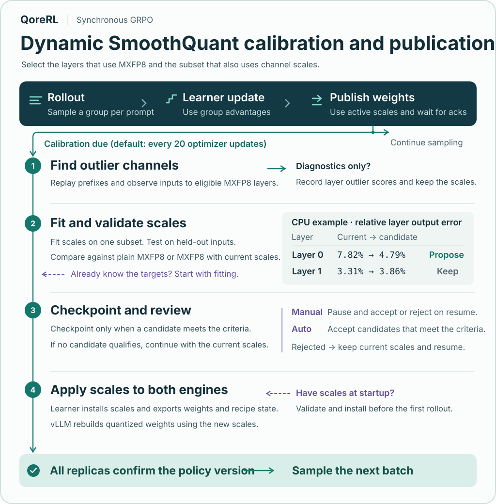

# QoreRL design and architecture

**English** · [简体中文](design.zh-CN.md)

## 1. What problem does QoreRL solve?

QoreRL packages quantization methods and techniques for reducing quantization error as reproducible **recipes**. Using a method from a paper in RL means applying it both when the rollout engine generates responses and when the learner uses those responses to update the policy. If a layer changes how it computes during training, users need to know what evidence justified the change, which batch first used it on both engines, and how to recover the state that preceded it.

### Recipes are the first-class abstraction

A recipe is what a user selects to run a method and what a developer adds to support a new one. For each run, the user chooses where the recipe applies and which changes it may make during training. The recipe defines the supported operators and their computation. If it supports adjustments, it also defines what can change and how to evaluate a candidate.

The framework gives recipes a shared training loop. It collects observations within the user's chosen scope, handles approval and checkpointing, and publishes an accepted change to the learner and rollout before the next batch. A developer adding a method can reuse that workflow and focus on what the method does and what evidence justifies applying it.

## 2. How to run a recipe

The first batch uses your chosen recipe settings for both rollout and training. What happens in later batches depends on what you enable at startup.


**Try “Allow changes” on CPU with manual approval.** From the repository root, run the example below.

```bash
uv run qorerl train --config configs/grpo_cpu_smoothquant.json --out runs/sq-review
```

This example simulates low precision and checks for a better setting after each optimizer update. When a candidate qualifies, training saves a checkpoint and pauses. Open `runs/sq-review/summary.json` to find the checkpoint, then read its `candidate.json` to see which layer would change and how its error compares. Accept to use the new setting for the next batch, or reject to resume with the current one. [Accept or reject and resume](docs/recipes/dynamic-smoothquant.md#manual-review-on-cpu)

<details>
<summary>What should I set in my own recipe configuration?</summary>

| Decision | Your choices |
| --- | --- |
| Where does it run from the first batch? | Choose the base precision and low-precision layers. An additional transform can start on a subset of those layers. |
| Where may it look during training? | Specify which eligible layers to measure and how often. Choose reports only if you want to review the measurements yourself. |
| What may it change? | For recipes that support updates, allow parameter refreshes or let the same transform expand within the original low-precision layer set. |
| Who approves? | Review a qualifying candidate yourself or preauthorize acceptance when the evidence meets your criteria. Both use the same publication path and wait for every rollout replica before the next batch. |

Already know the target layers? A recipe that supports fitting can compare candidates directly on those layers. Already have compatible calibration results? Import them at startup for the first batch. If a periodic check yields no qualifying candidate, training continues with the active settings.

</details>

## 3. Worked example: dynamic SmoothQuant

SmoothQuant assigns a scale to each input channel of a linear layer. Before quantization, it divides each input channel by its scale and multiplies the corresponding weight column by that same scale. The vector of scales is `S`. The user chooses which layers run in low precision, which of them also use `S`, and whether those scales may change during training.

### How does the user set scope and permissions?

This example selects the decoder's `mlp.down_proj` operators and uses the default format, MXFP8. Layer indices start at zero. The same four questions and selection rules apply to the experimental NVFP4 path. [Example configuration](configs/grpo_dynamic_smoothquant.json) · [Format and layer selection](qorerl/recipes/spec.py)

| Decision | Example configuration | Runtime behavior |
| --- | --- | --- |
| Initial scope | `layers: [7,15,20,25]`, `smoothquant_layers: [7,15,20]` | All four layers use MXFP8 from startup. Layers 7, 15 and 20 also use `S`. Layer 25 uses plain MXFP8. |
| Observation scope | `allow_layer_expansion: true`, `refresh_every_optimizer_steps: 20` | Each time the learner crosses a multiple of 20 optimizer updates, the next synchronous batch boundary triggers observation of inputs to these four layers. |
| Allowed changes | `discover_outliers: true`, `max_activation_relative_l2: 0.05` | Propose refreshing `S` on the first three layers or activating it on layer 25. The candidate must improve local output error. First-time activation also requires relative error at or below 5%. |
| Approval | `approval: "manual"` | When a candidate qualifies, save a checkpoint and pause. The user accepts or rejects it at resume. With `"auto"`, candidates that meet the same criteria are applied automatically. |

For a fixed run with offline scales, supply `scale_artifact` and set `refresh_every_optimizer_steps: 0`. For an outlier report, set `discovery_only: true`. To allow scale refreshes only on layers already using SmoothQuant, keep the default `allow_layer_expansion: false`. This limits calibration to the initially smoothed layers. [Configurations for each use case](docs/recipes/dynamic-smoothquant.md)

<a id="smoothquant-expansion"></a>

### When does layer 25 start using SmoothQuant?

| Stage | Layers 7, 15 and 20 | Layer 25 | Layer 23 and other layers outside the scope |
| --- | --- | --- | --- |
| First rollout | MXFP8 + SmoothQuant | Plain MXFP8 | BF16 |
| Calibration due | Compare current and candidate scales on the selected targets | If discovery finds an outlier, fit scales and compare plain MXFP8 with MXFP8 + candidate scales | BF16, outside calibration |
| Candidate awaiting review | Published scales remain active | Plain MXFP8 | BF16 |
| Approval and publication | Apply approved scale refreshes | If approved, use MXFP8 + SmoothQuant in the next batch after every rollout replica acknowledges the update | BF16 |
| Later calibration | Eligible for further refreshes | Eligible for scale refreshes after activation | BF16 |

**An outlier identifies a layer worth testing.** The learner replays trajectory prefixes from the batch it just trained on, using the updated weights. It fits the scales on some of the inputs and holds out others for comparison. For a given layer, both configurations use the same weights and held-out inputs, and both are compared with the same BF16 output. In a separate fixed-scope CPU example, two layers had outliers. New scales reduced relative error from 7.82% to 4.79% on one layer and increased it from 3.31% to 3.86% on the other. Only the first qualified. This comparison supports a local numerical decision. End-to-end reward and cost require a training run. [Candidate evaluation and example data](docs/recipes/dynamic-smoothquant.md)

### Why publish again when only the scales change?

Suppose layer 7's weights `W` have just been synchronized, and the user then accepts new scales. On the next forward pass, the learner computes `X / S` and `W * S` with the new values. vLLM still has weights cached using the **old scales**. Even though the underlying `W` is identical, rollout needs the new scales to rebuild its cache and execute the same transform as the learner. This publication preserves the weight version and changes the effective policy version. [Learner adapter](qorerl/recipes/megatron_mxfp8.py) · [Rollout adapter](qorerl/recipes/vllm_mxfp8.py)

<details>
<summary>See the SmoothQuant calibration and publication workflow</summary>



</details>

## 4. How the framework runs a recipe

The current native runtime uses synchronous GRPO. **The driver schedules work, Ray workers handle remote calls, and backend engines perform the computation.** A new recipe and its backend adapters implement its numerical operators, state, and candidate comparisons. The driver decides when to publish, which replicas receive the update, and when the next rollout can start.



### Who owns each part of a training batch?

Rollout generates a group of responses for each prompt. The driver checks the policy version and group completeness, computes rewards and group-relative advantages, and sends the training batch to the learner. After updating, the learner exports the weights and recipe state. The driver passes a Ray object reference to the same snapshot to every rollout replica and waits for all installation acknowledgements before the next batch. When calibration is due, candidate evaluation follows this regular weight publication. [Synchronous GRPO training loop](qorerl/runtime/ray_runtime.py)

| Component | Responsibility | Implementation |
| --- | --- | --- |
| Training driver | Schedule rollout, training and publication. Trigger calibration, checkpointing or a pause at a batch boundary. | [run_sync_grpo](qorerl/runtime/ray_runtime.py) |
| Ray workers | Own their engines, service remote calls, report readiness and acknowledge versions. | [ray_workers.py](qorerl/runtime/ray_workers.py) |
| Backend engines | Megatron and Transformer Engine train the model and export weights. vLLM installs weights and generates responses. | [Megatron learner](qorerl/engines/megatron.py) · [vLLM rollout](qorerl/engines/vllm.py) |
| Precision recipe | Select layers, define transforms and preserve their state. Recipes that support calibration also propose and evaluate changes. | [Specification](qorerl/recipes/spec.py) · [State](qorerl/recipes/state.py) · [Calibration](qorerl/recipes/calibration.py) |
| Task, algorithm and data | Define tasks, rewards, group-relative advantages, the loss, trajectory validation, and batches. | [Tasks](qorerl/training/tasks.py) · [Objective](qorerl/training/objective.py) · [Trajectory contracts](qorerl/training/contracts.py) · [Batching](qorerl/training/batching.py) |
| Observability | Recipe Insights replays fixed configurations on captured operands to record per-layer errors and timings. | [Recipe Insights](docs/recipe-insights.md) |

### Which version is active, and where can training resume?

Each batch of trajectories carries a `PolicyVersion(weight_version, recipe_id)`. The first field identifies the generation of published model weights. The second identifies the recipe. For dynamic SmoothQuant, the recipe ID includes a digest of the active per-layer scales, so changing only the scales gives the policy a distinct version. The learner keeps parameters and optimizer state in their original coordinates. Rollout rebuilds the inference weight cache for the new state. If publication fails, the driver stops the run and records the most recent complete recovery checkpoint. [Version identity](qorerl/recipes/state.py) · [Installation and acknowledgement](qorerl/engines/vllm.py)

When a candidate is awaiting review, the framework binds the proposal and its evidence to a checkpoint taken **before applying the change**. Users can resume from that point after either accepting or rejecting it. Manual and automatic approvals use the same publication path. Resume also checks recipe compatibility. Legacy expansion checkpoints that allowed BF16 layers to switch to MXFP8 require a fresh run with the current layer-selection rules. [Review and resume](qorerl/runtime/calibration.py) · [Compatibility checks](qorerl/runtime/checkpoint.py)

### Which files record a manual review?

Consider a three-layer CPU simulation. Layers 0 and 1 use MXFP8 and only layer 1 starts with SmoothQuant. Layer 2 is outside the low-precision scope. To exercise review, the test sets the calibration interval to one optimizer update. After the first training batch, the framework proposes enabling SmoothQuant on layer 0 and pauses. The following files tell the story in order. [Test that produces these artifacts](tests/test_calibration_workflow.py)

| Question | File | What the example records |
| --- | --- | --- |
| Why did training pause, and where can it resume? | Run directory, `summary.json` | The status is `awaiting_review`. The `checkpoint` field points to `checkpoints/step-000001-before-calibration/`. Pass the full `candidate_id` when accepting or rejecting. |
| What was active when the checkpoint was written? | Checkpoint directory, `metadata.json` | The first batch's weights have been published. Layers 0 and 1 use low precision, and only layer 1 uses SmoothQuant. The active version is in `policy_version`. Checkpoints with a pending proposal also contain `pending_candidate` and a sibling `candidate.json`. |
| Which layers would change, and why? | Same checkpoint, `candidate.json` | The `evidence` list contains every evaluated layer. Layer 0 is `proposed`, layer 1 is `no_gain`, and layer 2 is outside the scope. The only entry in `scale_artifact.scales` is the new scale vector for layer 0. |
| Did the decision take effect? | Run directory, `calibration.jsonl`, one event per line | The original run records `evaluated` followed by `awaiting_review`. On resume, the **new output directory** records `applied` or `rejected`. After acceptance, each trajectory in the second batch carries the `policy_version` recorded in `applied.policy`. |

<details>
<summary>Inspect the JSON written for this pause</summary>

These excerpts preserve the recorded field names and values. The full `metadata.json` also stores the configuration used to check resume compatibility. The `boundary` field records that all rollout replicas have acknowledged the current version and there are no samples in flight.

```json
{
  "schema": 2,
  "step": 1,
  "policy_version": {
    "weight_version": 1,
    "recipe_id": "mxfp8-smoothquant-mlp-down-v1:52badf3f31e93eab:b6e1880eba09c4845b562a93519ba3b449033125469094a655ac9506de039c25"
  },
  "pending_candidate": "4c65a5ecaf946494d4823a5b482433126f8616b1dd52acb75b765d27f6931428",
  "boundary": "all_rollouts_acknowledged_no_inflight_samples"
}
```

The excerpt from `candidate.json` shows the evidence for layer 0 and the first three of its 32 channel scales. Both relative L2 errors use the same BF16 output as the reference. On layer 0, plain MXFP8 has 7.82% relative error. With the candidate scales, it drops to 4.79%, a relative improvement of 38.74%.

```json
{
  "optimizer_steps": 1,
  "scale_artifact": {
    "kind": "smoothquant_scales",
    "scales": {
      "model.layers.0.mlp.down_proj.weight": [
        72647.875,
        1.6489697694778442,
        1.4567848443984985
      ]
    }
  },
  "evidence": [
    {
      "target": "model.layers.0.mlp.down_proj.weight",
      "action": "activate",
      "status": "proposed",
      "current_relative_l2": 0.07822830391426117,
      "direct_low_precision_relative_l2": 0.07822830391426117,
      "candidate_relative_l2": 0.04792346157040247,
      "relative_improvement": 0.3873897403818577
    }
  ],
  "checkpoint_sha256": "1f67499afd73ca03b8db4e3e008233e649d2e71aeea9a30047fc305aa0a53215"
}
```

The run's `summary.json` contains the full ID to pass to `--accept-candidate` or `--reject-candidate`.

```json
{
  "status": "awaiting_review",
  "last_step": 1,
  "candidate_id": "4c65a5ecaf946494d4823a5b482433126f8616b1dd52acb75b765d27f6931428"
}
```

Pass the checkpoint directory to `--resume`. The framework computes the candidate's ID and checks it against `metadata.pending_candidate`, checks its `source_policy` against `metadata.policy_version`, and compares the digest of the sibling `learner.pt` with `candidate.checkpoint_sha256`. These checks pair the reviewed proposal with the model and optimizer state that produced it. [Checkpoint writer](qorerl/runtime/checkpoint.py) · [Resume checks](qorerl/runtime/calibration.py) · [Accept or reject a candidate on CPU](docs/recipes/dynamic-smoothquant.md#manual-review-on-cpu)

</details>

The other run files connect that decision to the batch it affected. [Run artifact writer](qorerl/runtime/ray_runtime.py)

| Files | When to use them |
| --- | --- |
| `config.json`, `recipe.json`, `workers.json` | Check the resolved training configuration, the initial recipe specification and layer selection, and the processes that started. In this example, `layers: [0,1]` is the fixed low-precision scope, and `smoothquant_layers: [1]` is the initial set of smoothed layers. Publication records track subsequent changes to the scales and their coverage. |
| `metrics.jsonl`, `trajectories.jsonl` | Inspect a specific batch. The first file records one row per batch with metrics such as `reward_mean` and `clip_fraction`. The second records sampled tokens, behavior-policy log probabilities, policy versions, rewards and advantages. |
| `recipe_metrics.jsonl`, `incident.json` | Recipe Insights writes local comparisons when enabled and when it observes a layer. If training exits on an error, the incident file records the error type, message, and `last_recovery_checkpoint`. A normal pause for review appears in `summary.json`. |
