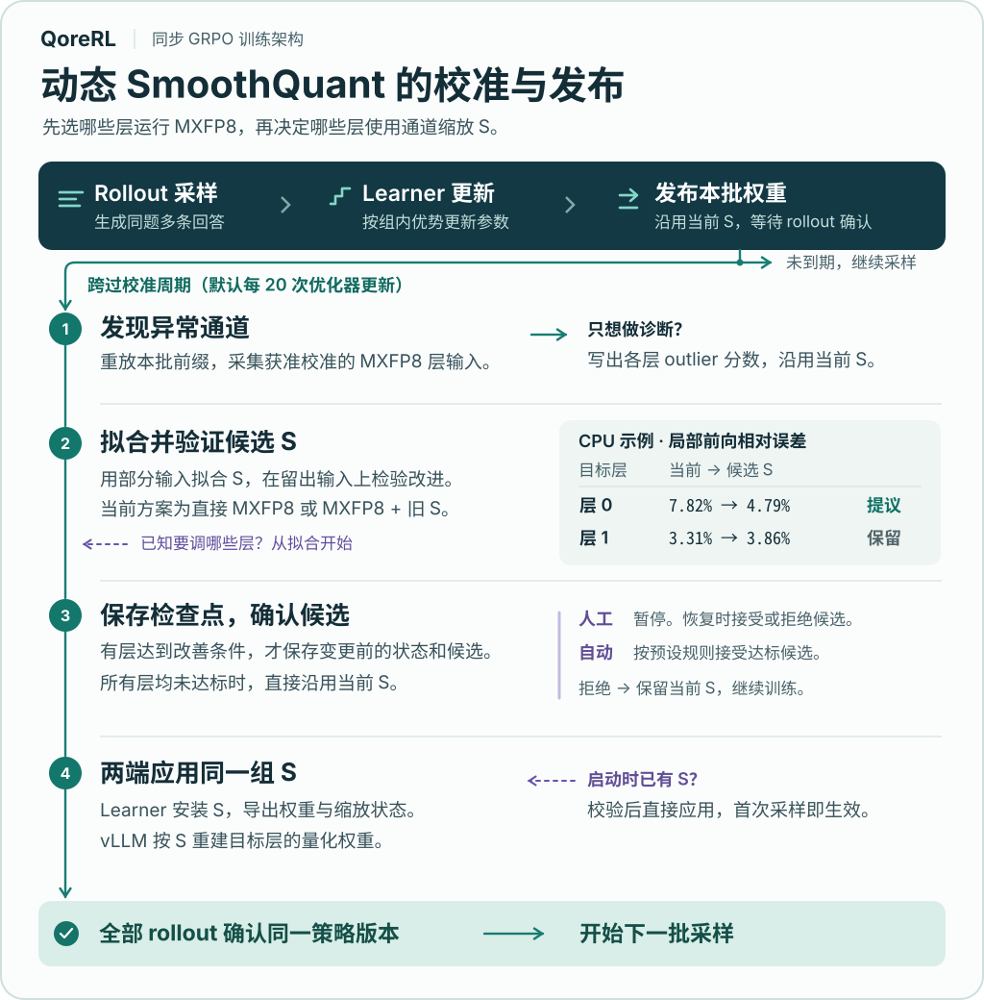

# QoreRL 设计原则与当前架构

QoreRL 把量化和量化误差缓解方法做成可复现的 **recipe**。一份 recipe 定义哪些层使用哪种数值计算、训练和采样两端各自怎样执行，以及哪些状态需要一起保存。用户选择方案，查看它在自己任务上的表现，再决定是否调整。框架负责让这个选择在指定范围内生效，并让每批样本都能追溯到实际使用的策略版本。

## 1. 用户能控制什么

每次运行先选一份 recipe。以动态 SmoothQuant 为例，**已启用层**实际执行 MXFP8 + SmoothQuant，**观察范围**决定校准时从哪里采集激活。观察 BF16 层只需要读取它的输入。它可以一直使用 BF16，直到用户授权的候选完成发布。

| 用户场景 | 用户设置 | 实际行为及实现入口 |
| --- | --- | --- |
| BF16 基线 | 省略 recipe 配置 | BF16 训练与采样，默认关闭周期校准。[训练配置](qorerl/training/config.py) |
| 固定使用一套方案 | 固定 Hadamard 配置层、分块和种子。固定 SmoothQuant 配置 `scale_artifact` 和 `refresh_every_optimizer_steps: 0` | Hadamard 旋转由配置决定。外部 S 在首次采样前导入，之后沿用。[旋转与缩放状态](qorerl/recipes/state.py) · [启动时导入](qorerl/runtime/ray_runtime.py) |
| 只观察 outlier | 设置 `discovery_only: true` | 周期结束时写发现报告并继续训练。原生 BF16 可观察所有 `down_proj`，固定范围的 MXFP8 recipe 观察已选层，允许扩层的 SmoothQuant 观察所有 `down_proj`。[输入采集](qorerl/engines/single_rank_learner.py) · [发现报告](qorerl/recipes/calibration.py) |
| 在指定层维护 SmoothQuant | 指定 `layers`，沿用默认固定范围。已知目标层时可设 `discover_outliers: false` | 只在这些层比较旧 S 和候选 S。可在启动时导入已有 S，后续继续刷新。[候选拟合与比较](qorerl/recipes/calibration.py) |
| 先启用少数层，后续允许扩层 | 指定初始 `layers: [7, 19]`，开启 `recipe_options.allow_layer_expansion: true` | 从第一批起仅初始层使用 MXFP8 + SmoothQuant。校准可观察所有 `down_proj`，为 BF16 层提议首次启用，也可为生效层提议刷新 S。两类变更都沿用所选 recipe。[选层](qorerl/recipes/spec.py) · [Megatron](qorerl/recipes/megatron_mxfp8.py) · [vLLM](qorerl/recipes/vllm_mxfp8.py) |
| 在用户授权范围内无人值守 | 选 SmoothQuant，设置 `approval: "auto"`。扩层权限单独配置 | 合格候选在检查点保存后自动发布。默认人工模式会暂停并等待决定。省略 `layers` 会从第一批起启用所有 `down_proj`。跨 recipe 自动选择属于长期目标。[审核与续训](qorerl/runtime/calibration.py) · [发布](qorerl/runtime/ray_runtime.py) |

校准周期按实际完成的优化器更新计数，默认每跨过 20 次更新，在随后的同步批边界检查一次。默认人工确认。发现、拟合和批准是独立的步骤，用户已有的证据或 S 决定从哪一步进入。[配置与默认值](qorerl/training/config.py) · [选层](qorerl/recipes/spec.py) · [校准条件](qorerl/recipes/calibration.py) · [运行示例](docs/recipes/dynamic-smoothquant.zh-CN.md)

### 扩层特例：第 23 层什么时候离开 BF16？

层号从 0 开始。假设第 7、19 层已启用，第 23 层是本次校准唯一合格的候选。人工确认针对本次候选清单整体进行。

| 时刻 | 第 7、19 层 | 第 23 层 |
| --- | --- | --- |
| 第一次采样 | learner 与 rollout 使用 MXFP8 + SmoothQuant | 两端使用 BF16 |
| 到达校准周期 | 采集激活，评估是否刷新现有 S | 采集 BF16 输入。发现 outlier 后，拟合 S，在留出输入上试算量化输出。实际训练与采样仍用 BF16。 |
| 展示候选 | 刷新候选比较旧 S 与新 S | 首次启用候选给出直接 MXFP8 和 MXFP8 + 候选 S 各自相对 BF16 的误差，让用户知道启用后的数值代价。 |
| 人工或自动决定 | 继续使用已生效的 S | 拒绝则继续 BF16。候选先随变更前的检查点保存。批准后由 learner 应用并发布新策略。全部 rollout 确认后，下一批才使用 MXFP8 + SmoothQuant。 |
| 后续校准 | 可继续刷新 S | 已进入生效范围，按同一套刷新规则比较旧 S 与新 S。 |

首次启用时，当前 BF16 输出相对自身的误差为零。若套用刷新 S 的“必须比当前误差低”，任何新层都进不来。首次启用要回答的是“把这个 BF16 层也量化，需要接受多少误差”。可以设置 `recipe_calibration.max_activation_relative_l2` 限定首次启用的误差。默认没有该上限，发现 outlier 且留出数据上的对照与候选均数值有效即可提议。是否优于直接 MXFP8 可从报告中对比。端到端成本、奖励和训练稳定性需要另外实测。

在三层 CPU 模拟测试中，初始只启用第 1 层。首轮校准发现第 0 层有 outlier，直接 MXFP8 的留出误差为 7.82%，配上候选 S 后为 4.79%。拒绝后仅第 1 层启用；接受后 learner 和两个 rollout 都启用第 0、1 层，第 2 层继续 BF16。后续校准将第 0 层视为已启用层。这是对上述流程的验证。[CPU 多进程测试](tests/test_calibration_workflow.py)

## 2. 一批训练由谁负责

**一个同步 GRPO 训练批**从 rollout 为每道题生成一组回答开始。编排端核对样本版本与分组完整性，计算奖励和组内优势，再把训练批交给 learner。learner 完成训练后导出权重，全部 rollout 副本安装并确认版本，下批采样才能开始。[训练主循环](qorerl/runtime/ray_runtime.py)

| 职责 | 负责的决定或计算 | 代码入口 |
| --- | --- | --- |
| 训练编排 | 安排采样、更新和发布，在批次之间触发校准、保存检查点或暂停 | [run_sync_grpo](qorerl/runtime/ray_runtime.py) |
| Ray worker | 各自持有 learner 或 rollout 引擎，接收远程调用，管理进程内资源 | [ray_workers.py](qorerl/runtime/ray_workers.py) |
| 后端引擎 | Megatron / Transformer Engine 执行训练并导出权重，vLLM 安装权重并生成回答 | [Megatron learner](qorerl/engines/megatron.py) · [vLLM rollout](qorerl/engines/vllm.py) |
| 精度 recipe | 选择目标层，定义数值变换和需要保存的状态，在后端实现对应算子 | [规格](qorerl/recipes/spec.py) · [状态](qorerl/recipes/state.py) · [后端适配](qorerl/recipes/) |
| 观测 | Recipe Insights 在采集到的操作数上重放固定方案，记录逐层误差和耗时，供用户比较 | [Recipe Insights](docs/recipe-insights.zh-CN.md) |
| 任务、算法与数据 | 定义任务和奖励，计算优势与 loss，校验轨迹并构造模型输入 | [任务](qorerl/training/tasks.py) · [目标函数](qorerl/training/objective.py) · [轨迹协议](qorerl/training/contracts.py) · [批处理](qorerl/training/batching.py) |

例如，给 SmoothQuant 增加一种估计 S 的方法，拟合与验证逻辑属于 recipe。何时暂停采样、恢复后向哪些副本发布，仍由编排端决定。这样可以分别修改数值方法和训练时序。

## 3. 只换 S，为什么还要重新发布？

假设第 7 层的权重 W 刚刚同步。此时用户接受了新的 S。learner 下次计算这层时，会用新的 S 对输入做 `X / S`，对权重的对应列做 `W * S`，然后量化。vLLM 则已经缓存了按**旧 S** 缩放、量化和重排的权重。要让下批采样也执行用户选定的方案，vLLM 必须同步新的 S 并重建缓存，即使 W 的数值完全相同。

**候选需要什么证据？** 默认每跨过 20 次实际优化器更新，learner 在同步批边界用更新后的权重重放刚训练的轨迹前缀。校准证据写入 `calibration.jsonl`。图中的 CPU 示例有两层都检出了 outlier。在相同的留出输入上，换 S 后，第 0 层相对同层 BF16 输出的误差从 7.82% 降至 4.79%，第 1 层却从 3.31% 升至 3.86%。因此只有第 0 层进入候选。这些证据回答的是该层的前向数值问题，训练奖励和端到端成本需要另外实测。[候选比较与 CPU 示例](docs/recipes/dynamic-smoothquant.zh-CN.md)

**批准的是哪一次变更？** 产生候选后，编排端先保存变更前的 learner、优化器和 recipe 状态，并把候选及证据与这个检查点绑定。人工模式暂停训练，用户恢复时按候选 ID 接受或拒绝这份变更。拒绝后沿用原 S。自动模式应用满足预设条件的候选。[确认与恢复实现](qorerl/runtime/calibration.py)

**如何知道下一批用的是新方案？** 每批轨迹记录 `PolicyVersion(weight_version, recipe_id)`。前者记录训练批的权重发布代次。对于动态 SmoothQuant，后者还标识 recipe 规格和当前各层 S 的内容摘要。只换 S 时，权重代次保持原值，策略版本仍会改变。learner 保留原坐标系的模型参数和优化器状态，发布权重与新的 recipe 状态。所有 rollout 重建缓存并确认预期版本后，编排端才放行采样。安装失败则停止本次运行，保留故障记录和最近的完整恢复点。[版本标识](qorerl/recipes/state.py) · [加载与确认](qorerl/engines/vllm.py)

## 4. 今天可以依赖到什么程度

| 状态 | 范围 |
| --- | --- |
| 本地已验证 | CPU Ray 多进程测试覆盖同步 GRPO、策略版本发布、SmoothQuant 的首次启用与刷新、接受与拒绝，以及从检查点继续训练。示例中的量化数字来自 CPU 模拟。[流程测试](tests/test_calibration_workflow.py) |
| 原生代码已实现，GPU 待验收 | 首个后端组合是单 rank dense Qwen3、Megatron / TE 和 vLLM，覆盖 BF16 基线及选定 MLP 输出投影的直接 MXFP8、固定 Hadamard 和动态 SmoothQuant。GPU 上的实际执行、refit 后同一 token 的训推概率差异、学习效果和成本均待测量。[运行与验收指南](docs/ray-grpo.zh-CN.md) |
| 后续工作 | 当前可从检查点确认的变更限于 SmoothQuant 候选。通用告警后的跨 recipe 调整、多 rank、MoE、异步训练，以及根据训练反馈自动选择修复方案，列入[开发计划](todo.md)。 |
