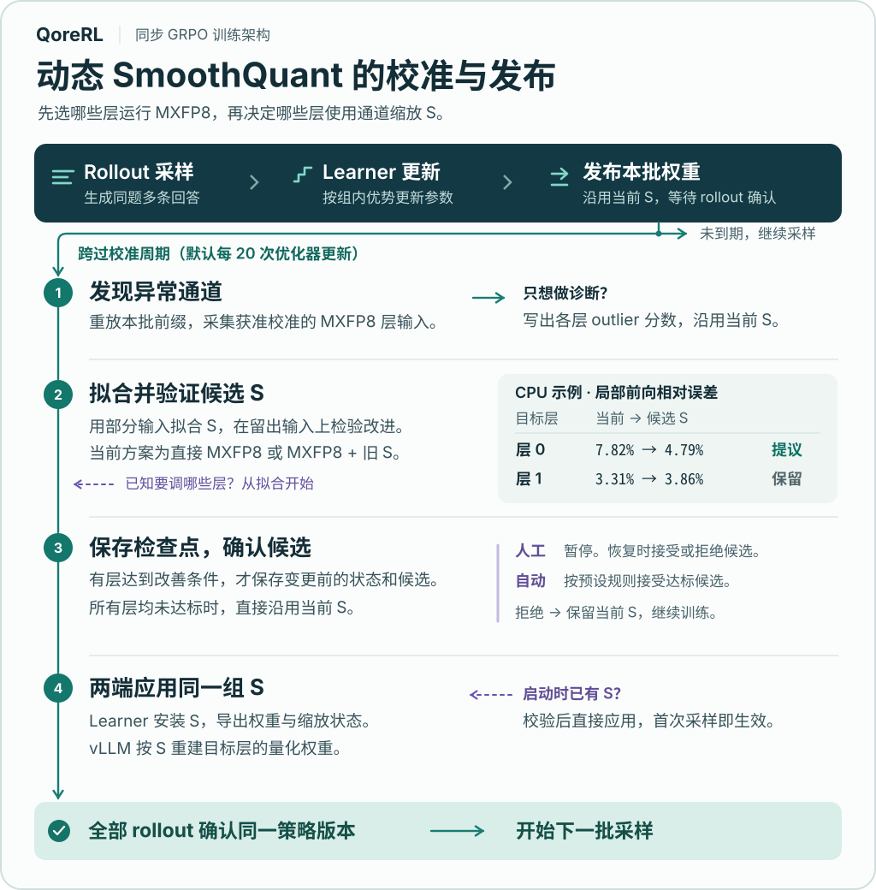

# QoreRL 设计原则与架构

[English](design.md) · **简体中文**

## 1. QoreRL 要解决什么问题

QoreRL 把量化和量化误差缓解方法做成可复现的 **recipe**。把论文中的方法用到强化学习时，采样端（rollout）要用它生成回答，训练端（learner）要用这些回答更新模型。如果中途改变了某些层的计算方式，用户还需要知道为什么值得改、两端从哪一批开始使用新方案，以及如何恢复到变更前的状态。

QoreRL 把这项工作分给两方。**Recipe 负责数值方法**，定义支持哪些算子、怎样执行，有可调参数时还要说明怎样提出和验证候选。**框架负责变更过程**，按用户给定的范围收集证据、处理审批、保存状态，并记录每批实际使用的策略版本。这样，换一种量化方法时，用户仍然可以用同一套流程决定让它运行在哪里、何时允许改变，以及要凭什么证据接受改变。

## 2. 一份 recipe 怎样进入训练

启动一份 recipe 时，用户先选定基础低精度格式和算子范围，再回答四个问题。如果只想按预设方案训练，确定初始范围即可。启用观测或允许调整时，其余问题才会影响运行行为。


| 用户的决定 | 它在训练中意味着什么 |
| --- | --- |
| **哪些层现在就用这个 recipe？** | 指定第一批开始就做低精度计算的层。如果 recipe 还提供额外变换，可以只在其中一部分层启用。 |
| **训练期间允许观察哪些层？** | 确定可以采集哪些层的数据。即便某个低精度层尚未启用额外变换，也可以观察它。观测期间继续用当前配置训练。 |
| **观察之后允许改什么？** | 用户可以只看报告、允许刷新已启用的参数，或允许给范围内的其他层启用同一种变换。可选动作取决于这份 recipe 支持的能力，低精度层名单在运行开始时固定。 |
| **谁批准这次修改？** | 有合格候选时，可交给用户查看证据后决定，也可由用户预先授权按验证条件自动接受。两种方式受同一组选层和变更权限约束。 |

**同一个流程可以从不同位置进入。** 只想知道哪些层有异常，可以读发现报告并沿用原方案。已经知道目标层，可以在 recipe 允许时跳过筛选，直接为这些层拟合和比较候选。手里已有兼容的离线校准结果，则可以在启动时校验、应用，从第一批起使用。

对支持周期调整的 recipe，一次观测可以产生零个或多个候选。每个候选应说清要改哪里、改成什么，以及在同一条件下比当前方案好在哪里。没有合格候选，或用户拒绝时，继续使用现行方案。接受后，框架在批次边界应用变更。若变更影响采样端的前向计算，要等两端都切换到新版本，再生成下一批回答。

## 3. 以动态 SmoothQuant 为例

SmoothQuant 给一个线性层的输入通道配一组缩放因子 `S`。计算时，每个输入通道除以自己的 S，权重的对应列乘以同一个 S，然后量化。对这份 recipe，用户可以控制低精度计算覆盖哪些层、哪些层额外使用 S，以及训练中是否允许更换 S。

### 用户怎样设置范围和权限？

下例选用默认格式 MXFP8，处理 decoder 中的 `mlp.down_proj`，层号从 0 开始。改用实验性的 NVFP4 时，四个问题和选层规则相同。[完整示例配置](configs/grpo_dynamic_smoothquant.json) · [格式与选层实现](qorerl/recipes/spec.py)

| 决定 | 示例配置 | 运行行为 |
| --- | --- | --- |
| 初始生效层 | `layers: [7,15,20,25]`，`smoothquant_layers: [7,15,20]` | 四层从启动起就跑 MXFP8，其中三层额外使用 S，第 25 层直接跑 MXFP8。 |
| 观测范围 | `allow_layer_expansion: true`，`refresh_every_optimizer_steps: 20` | 每跨过 20 次实际优化器更新，在随后的同步批边界观测这四层的输入。 |
| 可提议的变更 | `discover_outliers: true`，`max_activation_relative_l2: 0.05` | 可为前三层刷新 S，也可提议给第 25 层首次加 S。候选的局部输出误差须改善，首次启用还要求候选的相对误差不超过 5%。 |
| 批准方式 | `approval: "manual"` | 有合格候选时保存并暂停。用户接受或拒绝后从检查点继续。选 `"auto"` 则自动应用满足同样条件的候选。 |

同一份 recipe 也可以用得更简单。已有离线 S 时，提供 `scale_artifact` 并设 `refresh_every_optimizer_steps: 0`，训练全程使用导入的配置。只想看异常时可选 `discovery_only: true`。若只允许刷新现有 S，沿用默认的 `allow_layer_expansion: false`，校准只覆盖初始启用 S 的层。[各使用场景与配置](docs/recipes/dynamic-smoothquant.zh-CN.md)

<a id="smoothquant-expansion"></a>

### 动态扩展时，第 25 层什么时候用上 SmoothQuant？

| 时刻 | 第 7、15、20 层 | 第 25 层 | 第 23 层等名单外层 |
| --- | --- | --- | --- |
| 第一次采样 | MXFP8 + SmoothQuant | 直接 MXFP8 | BF16 |
| 到达校准周期 | 对入选层比较旧 S 和候选 S | 若发现 outlier，拟合 S，并比较直接 MXFP8 与 MXFP8 + 候选 S | 保持 BF16，不参与本轮校准 |
| 候选待审 | 继续使用已发布的 S | 继续直接 MXFP8 | BF16 |
| 批准并发布 | 应用获批的刷新 | 若获批，所有采样副本确认后，从下一批开始用 MXFP8 + SmoothQuant | BF16 |
| 后续校准 | 可继续刷新 S | 已启用后可继续刷新 S | BF16 |

**发现 outlier 只说明这一层值得试。** Learner 用更新后的权重重放刚训练的轨迹前缀，一部分输入用于拟合 S，留出另一部分输入做比较。对同一层、同一权重、同一份留出输入，分别计算当前方案和候选方案相对 BF16 输出的误差。在仓库的另一个固定范围 CPU 示例中，两层都出现了 outlier。换 S 后，一层的误差从 7.82% 降到 4.79%，另一层从 3.31% 升到 3.86%，所以只有第一层进入候选。这个比较能支持一次局部数值决策，端到端奖励和成本还需在训练任务上验证。[候选验证与示例数据](docs/recipes/dynamic-smoothquant.zh-CN.md)

### 只换 S，为什么还要重新发布？

假设第 7 层的原始权重 W 刚刚同步，用户随后接受了新的 S。下一次前向时，learner 会用新 S 计算 `X / S` 和 `W * S`。此时 vLLM 仍缓存着按**旧 S** 处理过的权重。即使 W 完全相同，采样端也需要拿到新 S 并重建缓存，才能与 learner 执行同一方案。这次发布后，权重代次保持不变，采样版本会随新的 S 更新。 [训练端适配](qorerl/recipes/megatron_mxfp8.py) · [采样端适配](qorerl/recipes/vllm_mxfp8.py)

<details>
<summary>查看动态 SmoothQuant 从校准到发布的完整流程图</summary>



</details>

## 4. 框架怎样执行这套流程

QoreRL 当前的原生实现采用同步 GRPO。**编排端安排工作，Ray worker 承接远程调用，后端引擎完成数值计算。** 引入新方法时，它的量化算子、需要保存的参数、候选比较逻辑由 recipe 及其后端适配实现。编排端决定什么时候发布、发布给哪些副本、什么时候开始下一批采样。



### 一批训练由谁负责？

Rollout 为每道题生成一组回答。编排端核对策略版本与分组完整性，计算奖励和组内优势，再把训练批交给 learner。Learner 更新后导出权重和 recipe 状态。编排端把同一个快照的 Ray 对象引用交给所有 rollout 副本，收齐安装确认后再开始下一批。到达校准周期时，候选评估发生在这次常规权重发布之后。[同步训练主循环](qorerl/runtime/ray_runtime.py)

| 职责 | 负责什么 | 代码入口 |
| --- | --- | --- |
| 训练编排 | 调度采样、更新和发布，在批次边界触发校准、保存或暂停 | [run_sync_grpo](qorerl/runtime/ray_runtime.py) |
| Ray worker | 持有各自的引擎、接收远程调用、报告就绪状态与版本 | [ray_workers.py](qorerl/runtime/ray_workers.py) |
| 后端引擎 | Megatron / Transformer Engine 执行训练并导出权重，vLLM 安装权重并生成回答 | [Megatron learner](qorerl/engines/megatron.py) · [vLLM rollout](qorerl/engines/vllm.py) |
| 精度 recipe | 定义选层和数值变换，保存变换状态。支持校准的方法还负责生成并验证候选 | [规格](qorerl/recipes/spec.py) · [状态](qorerl/recipes/state.py) · [校准](qorerl/recipes/calibration.py) |
| 任务、算法与数据 | 实现任务和奖励、组内优势、loss、轨迹校验和批处理 | [任务](qorerl/training/tasks.py) · [目标函数](qorerl/training/objective.py) · [轨迹协议](qorerl/training/contracts.py) · [批处理](qorerl/training/batching.py) |
| 独立观测 | Recipe Insights 在采集的操作数上重放固定方案，记录逐层误差和耗时 | [Recipe Insights](docs/recipe-insights.zh-CN.md) |

### 哪个版本在生效，训练从哪里恢复？

每批轨迹带有 `PolicyVersion(weight_version, recipe_id)`。前者标识权重的发布代次，后者标识 recipe。动态 SmoothQuant 的 `recipe_id` 还包含已生效的各层 S 的内容摘要。因此只改 S 也会得到一个可区分的策略版本。Learner 保留原坐标系下的参数和优化器状态，rollout 按新状态更新用于推理的权重缓存。若发布失败，编排端停止运行，并在故障记录中给出最近的完整恢复点。[版本标识](qorerl/recipes/state.py) · [加载和确认](qorerl/engines/vllm.py)

有待审候选时，框架把候选及证据绑定到**应用变更之前**的检查点。接受和拒绝都能从这个位置继续，人工和自动批准走同一条发布路径。恢复时还会检查 recipe 是否兼容。早期允许将 BF16 层升级为 MXFP8 的扩层检查点与当前选层规则不兼容，使用新规则需重新开始运行。[审核与恢复](qorerl/runtime/calibration.py) · [兼容性检查](qorerl/runtime/checkpoint.py)

### 一次人工确认会写下哪些文件？

下面缩成三层 CPU 模拟。第 0、1 层启用 MXFP8，初始只给第 1 层加 SmoothQuant。第 2 层在低精度范围之外。为演示审核，测试把校准周期设为一次优化器更新。第一批训练结束后，框架提议让第 0 层也启用 SmoothQuant，此时训练暂停。打开这次运行的输出目录，按下面的顺序读就能还原经过。[生成这些文件的测试](tests/test_calibration_workflow.py)

| 想知道什么 | 去哪里看 | 本例读到什么 |
| --- | --- | --- |
| 训练为什么停了，从哪里继续？ | 运行目录的 `summary.json` | `status` 是 `awaiting_review`。`checkpoint` 指向 `checkpoints/step-000001-before-calibration/`，`candidate_id` 是接受或拒绝时要传的完整 ID。 |
| 保存时实际生效的是哪个版本？ | 上述检查点的 `metadata.json` | 第 1 批的权重已经发布，第 0、1 层执行低精度计算，此时只有第 1 层启用 SmoothQuant。`policy_version` 标识当时生效的策略，`pending_candidate` 指向待审提案。普通检查点也有这份元数据，只有带候选的检查点才有这个字段和同目录的 `candidate.json`。 |
| 这次准备改哪一层，凭什么改？ | 同一检查点的 `candidate.json` | `evidence` 记录所有被评估的层。第 0 层为 `proposed`，第 1 层为 `no_gain`，第 2 层在范围外，证据中没有它的记录。真正要发布的新 S 只出现在 `scale_artifact.scales` 的第 0 层条目里。 |
| 用户的决定生效了吗？ | 运行目录的 `calibration.jsonl`，每行一个事件 | 原目录依次记录 `evaluated`、`awaiting_review`。人工接受并续训后，**新输出目录**记录 `applied`，选择拒绝则记录 `rejected`。接受分支的第 2 批在 `trajectories.jsonl` 中，每条轨迹的 `policy_version` 都与 `applied.policy` 一致。 |

<details>
<summary>展开查看这次暂停写入的实际 JSON</summary>

以下节选保留实际字段和值。`metadata.json` 还保存了用于续训兼容性检查的完整 `config`。这里的 `boundary` 表示所有 rollout 已确认当前版本，且没有在途样本。

```json
{
  "schema": 2,
  "step": 1,
  "policy_version": {
    "weight_version": 1,
    "recipe_id": "mxfp8-smoothquant-mlp-down-v1:52badf3f31e93eab:b6e1880eba09c4845b562a93519ba3b449033125469094a655ac9506de039c25"
  },
  "pending_candidate": "4c65a5ecaf946494d4823a5b482433126f8616b1dd52acb75b765d27f6931428",
  "boundary": "all_rollouts_acknowledged_no_inflight_samples"
}
```

`candidate.json` 下面只展示第 0 层的证据和该层 32 个通道中前 3 个 S。相对 L2 误差都以同一份 BF16 输出为参照。第 0 层当前是直接 MXFP8，误差为 7.82%。加上候选 S 后降至 4.79%，相对降幅为 38.74%。

```json
{
  "optimizer_steps": 1,
  "scale_artifact": {
    "kind": "smoothquant_scales",
    "scales": {
      "model.layers.0.mlp.down_proj.weight": [
        72647.875,
        1.6489697694778442,
        1.4567848443984985
      ]
    }
  },
  "evidence": [
    {
      "target": "model.layers.0.mlp.down_proj.weight",
      "action": "activate",
      "status": "proposed",
      "current_relative_l2": 0.07822830391426117,
      "direct_low_precision_relative_l2": 0.07822830391426117,
      "candidate_relative_l2": 0.04792346157040247,
      "relative_improvement": 0.3873897403818577
    }
  ],
  "checkpoint_sha256": "1f67499afd73ca03b8db4e3e008233e649d2e71aeea9a30047fc305aa0a53215"
}
```

运行目录的 `summary.json` 给出这次要审核的 ID，可直接传给 `--accept-candidate` 或 `--reject-candidate`。

```json
{
  "status": "awaiting_review",
  "last_step": 1,
  "candidate_id": "4c65a5ecaf946494d4823a5b482433126f8616b1dd52acb75b765d27f6931428"
}
```

续训时，`--resume` 接收整个检查点目录。框架校验候选内容算出的 ID 是否等于 `metadata.pending_candidate`、候选的 `source_policy` 是否等于 `metadata.policy_version`，以及同目录的 `learner.pt` 内容摘要是否等于 `candidate.checkpoint_sha256`。这样确认的就是当时看到的提案，恢复的也是与它配套的模型和优化器状态。[检查点写入](qorerl/runtime/checkpoint.py) · [续训校验](qorerl/runtime/calibration.py) · [接受或拒绝的命令示例](docs/recipes/dynamic-smoothquant.zh-CN.md#在-cpu-上走完一次人工确认)

</details>

要从审批追到实际采样的那一批，可以继续查运行目录里的记录。[运行文件写入位置](qorerl/runtime/ray_runtime.py)

| 文件 | 什么时候看 |
| --- | --- |
| `config.json`、`recipe.json`、`workers.json` | 复核启动条件时，分别查看解析后的训练配置、recipe 的规格及初始选层、实际启动的进程。本例 `recipe.json` 中的 `layers: [0,1]` 是固定的低精度范围，`smoothquant_layers: [1]` 是最初使用 S 的层。后续 S 的覆盖范围可从发布记录中核对。 |
| `metrics.jsonl`、`trajectories.jsonl` | 排查某个训练批时，前者每批一行，包含 `reward_mean`、`clip_fraction` 等。后者保留该批实际采样的 token、行为策略 log-prob、版本，以及对应的奖励与优势。 |
| `recipe_metrics.jsonl`、`incident.json` | 启用 Recipe Insights 且产生逐层观测时，前者记录局部比较。训练运行异常退出时，后者记录异常类型、消息和最近的恢复点 `last_recovery_checkpoint`。正常等待审核属于 `summary.json` 的状态。 |
