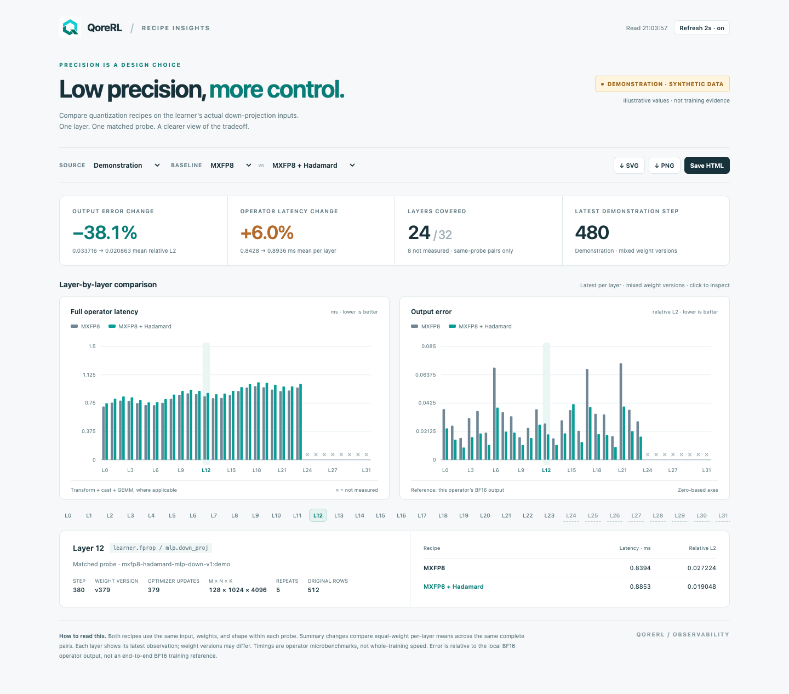
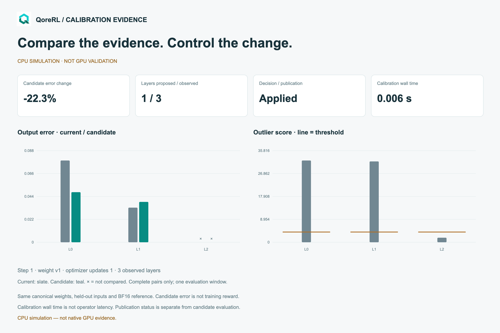

# 训练中的 Recipe Insights

[English](recipe-insights.md) · **简体中文**

Recipe Insights 在真实 learner 计算中截取少量输入和当前权重，配对比较 **BF16、MXFP8、MXFP8 + Hadamard** 的局部前向输出误差与耗时，并提供按层查看的实时页面和独立 HTML 报告。默认关闭；当前支持原生 Megatron 的直接 MXFP8 和固定 Hadamard MXFP8 recipe，**原生 GPU 执行与结果仍待验证**。



上图使用合成数据展示界面，不是 GPU 测量或训练收益证据。

## SmoothQuant：复用已有校准证据

SmoothQuant 展示直接读取 `calibration.jsonl`，不增加额外探针或前向回放。运行 `qorerl inspect --run RUN` 或 `qorerl report --run RUN --out report.html` 即可自动进入校准视图。不要为 SmoothQuant 开启原有固定方法的 `recipe_observation` 探针。其他 recipe 同时记录探针与发现证据时，可用 `--view probes` 或 `--view calibration` 显式选择，原有探针数据仍然可查看。



这张图来自 CPU 人工审核流程测试：第 0 层候选通过，第 1 层变差而未应用，第 2 层未选中。摘要比较的是**全部完整候选对**，包含未通过的比较，不是最终应用组合的整体收益；耗时也只属于这次微型 CPU 运行。

选择一个校准窗口，可以查看同一权重版本、同一留出输入下的当前/候选误差、outlier 分数、`refresh` 或首次 `activate`，以及独立的批准和发布状态。缺失数据不会补成零，不同权重版本不会混在一次比较里。评估出候选，不代表已经修改训练。

人工恢复后，显式关联之前的运行目录：

```bash
qorerl inspect --run results/sq-accepted --related-run results/sq-review
qorerl report --run results/sq-accepted --related-run results/sq-review --out results/sq-report.html
```

新增可选 `evaluation_id` 串联评估、保存的候选与决策；兼容旧日志中的 candidate ID 和本段评估边界。关联多条恢复分支时，分别展示结果。`evaluation_seconds` 表示校准墙钟耗时，`apply_publish_seconds` 表示批准后的应用与发布耗时，两者都不是算子延迟或 FLOPs 节省。页面区分 CPU 模拟、原生配置和来源未知；GPU 验证单独进行。[GPU 实验与验收工具](gpu-validation.zh-CN.md)

## 启用真实观测

在已配置 CUDA 依赖的环境中，将以下配置保存为 `configs/grpo_mxfp8_observed.json`。未列出的训练参数采用 `TrainConfig` 默认值；原生环境与硬件要求见 [recipe 说明](recipes/mxfp8-hadamard.zh-CN.md)。

```json
{
  "steps": 40,
  "recipe_id": "mxfp8-hadamard-mlp-down-v1",
  "recipe_options": {"block_size": 128, "seed": 0},
  "recipe_observation": {
    "enabled": true,
    "every_steps": 20,
    "layers_per_window": 2,
    "max_rows": 128,
    "repeats": 5,
    "max_snapshot_bytes": 134217728
  }
}
```

```bash
qorerl train --config configs/grpo_mxfp8_observed.json --out results/grpo-observed
```

另开终端查看，或在训练后导出可独立打开的报告：

```bash
qorerl inspect --run results/grpo-observed --port 8765
qorerl report --run results/grpo-observed --out results/grpo-observed/report.html
```

实时页面地址为 [http://127.0.0.1:8765](http://127.0.0.1:8765)，只监听本机。页面读取运行目录中的 `config.json` 和 `recipe_metrics.jsonl`，展示层覆盖、最近观测和三种方案的局部比较。页面默认每 2 秒读取一次，可暂停刷新；独立 HTML 嵌入导出时的数据，不继续刷新。页面的 SVG / PNG 按钮可导出包含来源标识、摘要和两张按层对比图的完整图片，Save HTML 保存当前来源及对比组合。

## 采样和状态边界

- 默认首个窗口在 **step 20**，随后为 40、60……；仓库原有 10 步 smoke 配置不会产生默认窗口。每个窗口从 recipe 已安装的目标层中轮转选择最多两层，不额外观测未安装的层。
- 每层只截取本轮第一个 epoch、第一个 microbatch 中首次执行的 down projection。将实际输入的前导维视作行，复制前至多 128 行和完整 canonical BF16 权重；这是前缀采样，包含当时的 prompt/response/padding 布局，不是随机或无偏样本。
- 捕获发生在训练侧旋转之前。首个 microbatch 的反向和图释放后、optimizer 更新前，在独立副本上以 `no_grad` 重放；不替换训练输出，不改参数、梯度、optimizer 或 recipe 状态，并恢复随机数状态。全零优势时仍可观测，实际 optimizer step 数不会因此增加。
- 记录中的 `step` 是本轮训练 batch 序号；`weight_version` 和 `optimizer_steps` 是捕获时的更新前值。例如正常从零开始时，step 20 对应 weight version 19。窗口由进度推导，恢复无需保存额外 probe 状态；可在保持训练语义不变的恢复中调整观测配置。

`max_snapshot_bytes` 限制一个窗口保留的 **输入和 canonical 权重副本总字节数**，默认 128 MiB。它不包含 Hadamard FP32 临时张量、量化表示、输出或 CUDA workspace，不能当作额外显存峰值上限。超出副本预算或选中层未执行会写 `skipped`；可恢复的采集/重放失败写 `error`。缺失、跳过和错误都不代表零误差；不可安全继续的 CUDA 错误仍会停止训练。

## 数字能说明什么

| 字段 | 含义与边界 |
| --- | --- |
| `shape_mnk` | 实际采样行数 M、输出通道 N、输入通道 K；`original_rows` 保留采样前行数 |
| `output_relative_l2` | `‖Y_variant − Y_bf16‖₂ / ‖Y_bf16‖₂`；三组使用同一份 X、W，BF16 自身为零 |
| `latency_ms` | 每组先预热一次，再交错执行默认 5 次，取 CUDA event 耗时中位数；包含本次调用的旋转、量化、padding 和 GEMM，未缓存旋转或量化后的权重 |
| `probe_seconds` | 主机捕获耗时加重放墙钟时间；同步可能等待此前排队的训练工作，异步副本耗时也未单独隔离，因此不是可从训练耗时直接扣除的纯观测开销 |

BF16 参考是同一 X、W 上的 **`torch.nn.functional.linear`**，不是完整模型的 BF16 重跑，也不是原 Megatron 层的端到端性能对照。上游激活已经来自当前训练 recipe；这里测得的是该局部算子对同一输入的差异。Hadamard 分支包含 BF16 变换舍入和 MXFP8 量化的共同误差。

CUDA event 数字是采样形状上的局部前向耗时，不是 FLOPs、完整层/模型吞吐或训练总成本。它不计 Dgrad/Wgrad、rollout、权重同步、checkpoint 和达到某个质量所需的训练时间。跨层最近记录还可能来自不同 step；误差更小或局部调用更快，都不能直接证明训练收益或端到端加速。完整成本仍需结合训练日志和后续 GPU 验收。

## 无 GPU 的界面预览

在本地开发环境安装项目后运行：

```bash
qorerl demo-report --out results/insights-demo
qorerl inspect --run results/insights-demo --port 8765
qorerl report --run results/insights-demo --out results/insights-demo/report.html
```

`demo-report` 只创建新的目录，已有目录会拒绝覆盖。所有记录标记为 `source=demo`，页面明确显示演示状态；这些曲线不能用于精度、性能或质量结论。真实 GPU 记录使用 `source=measured`，也仍须按上述测量范围解读。
