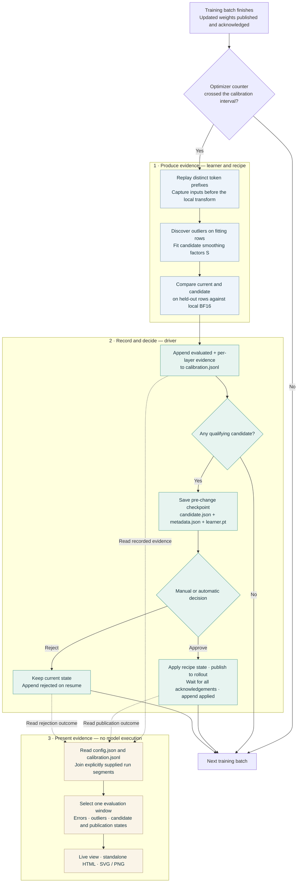

# SmoothQuant calibration: from training inputs to a visible decision

**English** · [简体中文](smoothquant-calibration.zh-CN.md)

QoreRL separates three responsibilities: **the learner and recipe produce calibration evidence; the driver records, reviews and publishes a change; the viewer reads and presents that evidence.** Opening a page, refreshing a chart or exporting a report does not load a model or run another GPU calibration. Calibration itself does perform additional forward computation.

This document follows the current implementation through those three responsibilities. For recipe choices and hardware setup, see the [SmoothQuant guide](recipes/dynamic-smoothquant.md). For native experiment acceptance, see [GPU validation](gpu-validation.md). The walkthrough below uses real CPU training and quantization simulation, not native GPU measurements.

## 1. The complete path



Manual approval pauses **by exiting the training process and releasing workers**. The user reviews the saved proposal, then resumes into a new output directory with an explicit acceptance or rejection. Automatic approval uses the same checkpoint, application and publication path in the current run. A discovery-only run stops after recording outlier evidence and produces no candidate.

## 2. How calibration produces evidence

### Configure the scope, schedule and decision

The following fragment belongs in a training config. Layer numbers are zero-based. It defines an immutable low-precision scope and a smaller initial SmoothQuant overlay:

```json
{
  "recipe_id": "smoothquant-mlp-down-v1",
  "recipe_options": {
    "precision": "mxfp8",
    "layers": [7, 15, 20, 25],
    "smoothquant_layers": [7, 15, 20],
    "allow_layer_expansion": true
  },
  "recipe_calibration": {
    "refresh_every_optimizer_steps": 20,
    "discover_outliers": true,
    "discovery_only": false,
    "outlier_threshold": 4.0,
    "alpha": 0.5,
    "max_rows": 128,
    "min_relative_improvement": 0.0,
    "max_activation_relative_l2": 0.05,
    "approval": "manual"
  }
}
```

Layers 7, 15, 20 and 25 all use MXFP8 from the start; only 7, 15 and 20 start with S. Expansion observes all four and may propose S for layer 25. It **cannot turn another BF16 layer into a low-precision layer, or switch to Hadamard**. With expansion disabled, observation is limited to layers already using SmoothQuant. The optional first-activation error cap above is 5%; its default is `null`, meaning no additional cap.

The driver calls `crosses_interval(before, after, interval)` after the normal training update and weight publication. It tests `before // interval < after // interval`, with a positive interval. The counter is **actual optimizer updates**, not rollout batches, microbatches or viewer refreshes. Moving from 19 to 22 updates causes one calibration at that batch boundary; a batch that makes no optimizer update does not advance this schedule. Restore preserves the counter.

Relevant code: [configuration and shared discovery](../qorerl/recipes/calibration.py), [scope in RecipeState](../qorerl/recipes/state.py), [interval test](../qorerl/runtime/calibration.py), [driver](../qorerl/runtime/ray_runtime.py).

### Collect inputs from the just-consumed batch

`SingleRankGRPOLearner.prepare_candidate(batch)` validates the sample policy, collects inputs and dispatches to `RecipeSpec.candidate_handler`. SmoothQuant owns the fitting and application functions; the driver does not calculate S.

The learner replays **recorded tokens** using its updated model. It does not ask rollout to sample another set of responses. `_calibration_prefixes` builds contexts from `prompt_ids + response_ids[:-1]`, deduplicates shared causal prefixes and bounds the total number of new token rows. `_sample_calibration_inputs` replays one unpadded sequence at a time under `no_grad` and captures up to `max_rows` per observed projection.

On the native learner, `MegatronRecipeInstallation.forward` calls `calibrator.capture(name, x)` **before** `transform_input` and `transform_weight`. Thus the captured X precedes this layer's SmoothQuant transformation, but it already contains the effects of upstream layers. Canonical W remains the model's BF16 weight, stored as `[output_channels, input_channels]`.

`activation_windows` splits the bounded rows in order: the first `floor(n / 2)` rows fit the candidate, and the remainder evaluate it. Identical token prefixes are not repeated across this split, but both halves can still come from the same response; this is not an independent task-level validation set. Discovery-only mode uses all rows for discovery.

The driver records both `sample_policy` (the policy that generated the tokens) and `policy` (the updated policy used for evaluation). Raw activation matrices and replay outputs remain temporary in-memory data; **`calibration.jsonl` is an evidence log, not an activation dataset**.

Relevant code: [prefix replay and capture](../qorerl/engines/single_rank_learner.py), [native projection adapter](../qorerl/recipes/megatron_mxfp8.py), [recipe dispatch](../qorerl/recipes/spec.py).

### Discover, fit and compare

For each input channel j, fitting computes:

```text
x_max[j] = max over fitting rows of abs(X[:, j])
w_max[j] = max over output channels of abs(W[:, j])
outlier_score = max(x_max) / mean(x_max)
S_new[j] = x_max[j]^alpha / w_max[j]^(1 - alpha)
```

The outlier score measures channel-magnitude imbalance within one layer; it is not the percentage of outlier tokens. Channels without usable nonzero activation and weight maxima retain their current factor; a newly activated layer starts from ones. Fitting uses FP64 arithmetic and stores the resulting positive factors in FP32. `S_new` is relative to canonical W and replaces the layer's old S, rather than multiplying it again.

**S is the SmoothQuant smoothing factor, not the quantizer's scale.** The transform pairs `X / S` with `W * S` along input channels. Quantization then derives its own block scales from those transformed operands. In exact arithmetic the paired transform preserves the linear output; finite precision and quantization are why we measure it.

For a selected layer, all three evaluations share the **same held-out X and canonical W**:

| Evaluation | Computation |
| --- | --- |
| Local reference | `Y_ref = F.linear(X_heldout, W)` in BF16 |
| Current configuration, `refresh` | Low-precision forward with the existing S |
| Current configuration, `activate` | Direct low-precision forward, without SmoothQuant |
| Candidate | The same low-precision kernel with `X_heldout / S_new` and `W * S_new` |

The measured error is `||Y - Y_ref||₂ / ||Y_ref||₂`. A proposal requires strictly smaller candidate error, relative improvement `(before - after) / before >= min_relative_improvement`, and a factor vector that actually changes. First activation also requires outlier evidence and satisfies `max_activation_relative_l2` when configured. With `discover_outliers: false`, existing SmoothQuant targets bypass the outlier threshold, but newly activated targets still need to meet it.

`prepare_smoothquant_candidate` returns **only qualifying factor vectors**, plus evidence for **every observed layer**. It does not mutate installed state. A high outlier score can still lead to `no_gain`. The CPU fixture injects a simulated kernel; the native adapter supplies its selected low-precision kernel.

Relevant code: [`activation_windows`](../qorerl/recipes/calibration.py), [`prepare_smoothquant_candidate`, `_fit_smoothing_factor`, `_error`](../qorerl/recipes/smoothquant.py).

## 3. How evidence, candidates and decisions are written

### Each file has a different job

```text
results/sq-review/
├── config.json
├── calibration.jsonl
├── publications.jsonl
├── trajectories.jsonl
├── summary.json
└── checkpoints/step-000001-before-calibration/
    ├── metadata.json
    ├── candidate.json
    └── learner.pt
results/sq-accepted/                 # New directory on manual resume
├── config.json
├── calibration.jsonl               # applied/rejected; later evaluations if due
├── publications.jsonl
└── trajectories.jsonl
```

This is the relevant subset of files from a manual-review run, not an exhaustive directory listing.

| File | Producer and purpose | Read by the calibration viewer? |
| --- | --- | --- |
| `config.json` | Driver: resolved training configuration; identifies configured backend and recipe. | Yes |
| `calibration.jsonl` | Driver: append-only evaluations, per-layer evidence and decision events. One complete JSON object per line. | Yes |
| `candidate.json` | Checkpoint writer: proposed recipe artifact, evidence, source policy, evaluation ID and learner payload digest. | No; used for review and resume |
| `metadata.json` | Checkpoint writer: training progress, saved policy, config, boundary and pending candidate ID. | No; used for resume |
| `learner.pt` | Learner: model, master parameters, optimizer, counters, recipe state and other recovery state. | No |
| `publications.jsonl` | Driver: published policy and each rollout acknowledgement. | No; inspect for publication audit |
| `trajectories.jsonl` | Driver: sampled tokens, rewards, advantages and generating policy. | No; inspect to verify the next batch used the published policy |
| `summary.json` | Driver: completion/pause status, checkpoint path and pending candidate ID. | No; used to operate the run |

An `incident.json` file records a failure and recovery point. The viewer checks its presence and displays a warning; it does not recover training.

### Example: one layer's evidence

The following **illustrative** event is pretty-printed for reading; the actual JSONL writer emits one line. IDs are placeholders and the numbers are explanatory, not GPU results. A real `evidence` array contains every observed layer.

```json
{
  "event": "evaluated",
  "evaluation_id": "example-evaluation-001",
  "step": 20,
  "policy": {"weight_version": 20, "recipe_id": "<active-recipe-before>"},
  "sample_policy": {"weight_version": 19, "recipe_id": "<active-recipe-before>"},
  "optimizer_steps": 20,
  "evaluation_seconds": 0.25,
  "evidence": [{
    "target": "model.layers.7.mlp.down_proj.weight",
    "action": "refresh",
    "selection": "outlier",
    "outlier_score": 12.0,
    "threshold": 4.0,
    "alpha": 0.5,
    "fit_rows": 64,
    "heldout_rows": 64,
    "status": "proposed",
    "reason": null,
    "current_relative_l2": 0.08,
    "candidate_relative_l2": 0.05,
    "relative_improvement": 0.375
  }]
}
```

The 8% and 5% values are errors relative to the local BF16 output. The improvement is 37.5%, not 3%. First activation additionally records `direct_low_precision_relative_l2` and `max_activation_relative_l2` in the raw evidence.

Per-layer statuses and run-level events answer different questions:

| Per-layer status | Meaning |
| --- | --- |
| `discovered` | Selected by discovery; may be the final result in discovery-only mode. |
| `not_selected` | Did not meet the discovery threshold; no candidate comparison. |
| `proposed` | Passed the recipe's local comparison; not yet proof of application. |
| `no_gain` | No strict improvement, insufficient requested gain, or unchanged factors. Both measured errors remain visible when available. |
| `activation_cost_exceeded` | First activation exceeds the configured output-error cap, despite an improvement. “Cost” here is error, not runtime or FLOPs. |
| `insufficient_rows`, `insufficient_signal`, `invalid_candidate` | Evidence or candidate is unusable; `reason` explains why. |

| Run-level event | When the driver writes it |
| --- | --- |
| `evaluated` | After learner preparation returns, even if there is no qualifying candidate. |
| `awaiting_review` | After saving a qualifying proposal and pre-change checkpoint, before exiting for manual review. |
| `applied` | After applying the approved proposal and completing required publication/acknowledgements. |
| `rejected` | On explicit rejection during resume; the saved active state remains in use. |
| `imported` | After applying an offline initial artifact and publishing it before first sampling. This has no newly measured comparison. |

`append_json` writes with `allow_nan=False` and ends each event with a newline. The driver is the writer; the learner returns the artifact and evidence over Ray. These logs are not a transactional database. Checkpoints use a temporary directory and rename it into place only after their files exist.

### Bind approval to the exact saved proposal

The schema-2 `candidate.json` envelope contains `source_policy`, `optimizer_steps`, `candidate`, `evidence`, `evaluation_id` and `checkpoint_sha256`. Its nested SmoothQuant artifact contains the model/revision, base recipe identity, per-target factor vectors and their digest. Only qualifying layers are included in this candidate mapping; the checkpoint retains all active recipe state.

The artifact still uses the schema-1 names `kind: "smoothquant_scales"`, `scales` and `scale_digest` for compatibility. They contain **SmoothQuant factors**, not low-precision quantizer scales. Python code uses `smoothing_factors`; the JSON names are a preserved wire format.

`candidate_id` is the SHA-256 of the serialized review envelope, including the learner checkpoint digest. It is stored as `metadata.pending_candidate` and exposed in `summary.json` and event records. Resume checks the review ID, source policy, supplied decision ID and `learner.pt` digest. Do not hand-edit a saved candidate after reviewing its ID. Schema-1 reviews remain readable under their former `scale_artifact` field.

After acceptance, the recipe validates and merges the factors into `RecipeState`. S can change without an optimizer update: `weight_version` stays the same while the factor digest changes `recipe_id`. Rollout must receive that new state and rebuild transformed/packed weights. All replicas acknowledge the expected policy before the next sampling batch. On publication failure the driver stops and records a recovery point rather than continuing with mixed versions.

Relevant code: [review envelope and validation](../qorerl/runtime/calibration.py), [checkpoint publication](../qorerl/runtime/checkpoint.py), [application and logging](../qorerl/runtime/ray_runtime.py), [recipe application](../qorerl/recipes/smoothquant.py), [rollout packing](../qorerl/recipes/vllm_mxfp8.py).

## 4. How the viewer presents existing evidence


`qorerl inspect` starts the local HTTP server in `observability/viewer.py`. `load_report` calls `load_calibration` for the main directory and any explicit `--related-run` directories. It renders `calibration.html`; the live page polls `/api/report` every two seconds. Reading a new event updates the charts. This is **live log viewing**, not continuous model recalibration.

### One window, paired comparisons and separate outcomes

Each `evaluated` event becomes a selectable window. The page shows its run, batch, optimizer counter, evaluation policy, sample policy and evidence. Per-layer paired error bars compare current/candidate values; the second chart displays outlier scores and their thresholds. The layer table includes `activate`/`refresh`, fitting/held-out row counts, status and reason. The event table separately displays linked approvals/publications.

The summary computes equal-weight means of current and candidate errors over **all complete pairs in the selected window**, including `no_gain` candidates. It then displays `(mean_candidate - mean_current) / mean_current * 100`. A reduction is negative on the dashboard, whereas `relative_improvement` in evidence is positive. This summary is neither the effect of the applied combination nor an average of per-layer percentage improvements. “Proposed / observed” counts `status == "proposed"` against the number of evidence rows, not all model layers.

Missing values stay `null` and appear as `—` or `×`, never zero. Different weight versions are not merged into one layer comparison. The viewer recalculates relative improvement from each complete error pair. `evaluation_seconds` is preparation wall time, including the driver/Ray wait; `apply_publish_seconds` is application and publication wall time. Neither is operator latency or compute saved.

### Join a decision across resume directories

The original run writes `evaluated` and `awaiting_review`; a resumed run writes `applied` or `rejected` in its own directory. Supply both explicitly:

```bash
uv run qorerl inspect --run results/sq-accepted \
  --related-run results/sq-review --view calibration --port 8765
```

`evaluation_id` links the evaluation to its review and decision; `candidate_id` also links outcomes for the same saved proposal. For older records without evaluation IDs, the reader associates an event with the preceding same-step evaluation **within that run**, then uses a matching candidate ID to connect explicit run segments. It does not guess that equal step numbers in different runs mean the same evaluation, or open paths mentioned inside logs. Several supplied decision branches produce `multiple_branches` instead of overwriting one outcome with another.

For live reads, `read_events` defers a final line without its terminating newline. Completed malformed records produce warnings. Reads are bounded to the latest 16 MiB per JSONL file with a visible warning if earlier history was omitted. The execution-source badge comes from each run's backend configuration (`cpu_simulation`, `native_gpu`, or `unknown`); it is not a GPU acceptance certificate.

### Export without rerunning calibration

| Output | Implementation and contents |
| --- | --- |
| CLI HTML report | `export_report` embeds the loaded evidence, page code and logo with live polling disabled. It needs no model, checkpoint tensors or network connection to view. |
| **Save HTML** in the page | Saves the current loaded report and selected evaluation window as an offline snapshot. |
| **SVG** in the page | `exportSvg` draws the selected window's source label, summary, error/outlier charts and measurement notes into a 1200 × 800 image. |
| **PNG** in the page | Rasterizes that SVG using a browser canvas at 2400 × 1600. |

Images summarize the selected window; they are not a full event archive. Keep the JSONL files and HTML when readers need to inspect other windows or individual outcomes. No viewer operation calls `prepare_candidate` or `apply_candidate`; decisions remain explicit training commands.

Relevant code: [file parsing and joins](../qorerl/observability/calibration.py), [HTTP server and HTML export](../qorerl/observability/viewer.py), [charts, polling and image export](../qorerl/observability/calibration.html), [CLI](../qorerl/cli.py).

## 5. Reproduce the complete workflow on CPU

Run from the repository root with the project environment installed. Each training output directory must be new. The [CPU config](../configs/grpo_cpu_smoothquant.json) uses a tiny fixture, simulated low precision, three initial SmoothQuant layers and calibration every actual update.

```bash
uv run qorerl train --config configs/grpo_cpu_smoothquant.json --out results/sq-review
uv run qorerl inspect --run results/sq-review --view calibration --port 8765
```

Open `http://127.0.0.1:8765`. Inspect the first window and the saved `candidate.json`. In another terminal, read the exact recovery point and decision ID:

```bash
CP=$(uv run python -c 'import json; print(json.load(open("results/sq-review/summary.json"))["checkpoint"])')
ID=$(uv run python -c 'import json; print(json.load(open("results/sq-review/summary.json"))["candidate_id"])')
uv run qorerl train --config configs/grpo_cpu_smoothquant.json \
  --resume "$CP" --accept-candidate "$ID" --out results/sq-accepted
uv run qorerl report --run results/sq-accepted --related-run results/sq-review \
  --view calibration --out results/sq-calibration.html
```

Select the **original evaluation window** in the report to see its linked `Applied` decision. Later windows can have different outcomes. Use the SVG/PNG buttons to export that window. To inspect both directories live, stop the first viewer and run the command in section 4. To reject instead, resume the same pre-change checkpoint into another new directory with `--reject-candidate "$ID"`.

Rerunning the CPU config while writing this document produced the following first window, with four fitting rows and five held-out rows per layer. These numbers belong only to this simulated fixture:

| Layer | Outlier score | Current relative L2 | Candidate relative L2 | Outcome |
| --- | ---: | ---: | ---: | --- |
| 0 | 31.98 | 0.078228 | 0.047923 | `proposed`: propose a refresh |
| 1 | 31.62 | 0.033125 | 0.038617 | `no_gain`: keep the active S |
| 2 | 1.78 | — | — | `not_selected`: no candidate comparison |

After acceptance, the first window linked to `applied`, the resumed run completed batch 3, and HTML export succeeded. **Discovering an outlier, qualifying a candidate and publishing a change are three different outcomes.**

Verify three different facts: (1) evidence explains which layer qualified; (2) `applied` and `publications.jsonl` show the new policy was published; (3) the next batch's trajectories carry that policy. The existing [workflow tests](../tests/test_calibration_workflow.py) also compare manual acceptance with automatic approval and cover first activation within the low-precision scope. [Viewer tests](../tests/test_calibration_viewer.py) cover joins, branches, incomplete log lines and standalone export.

## 6. Interpret the result at its measured scope

Calibration measures **local forward error on sampled inputs**. It does not establish which layer caused an end-to-end training failure, measure gradient error, or prove reward, convergence, FLOP or throughput gains. Updating several layers can change downstream inputs, which requires further training-level evaluation.

SmoothQuant's viewer consumes `calibration.jsonl`; it does **not** require the separate `recipe_observation` probe. That probe compares fixed BF16/MXFP8/Hadamard methods and writes `recipe_metrics.jsonl`. Enabling it for SmoothQuant is not the way to obtain these charts. See [Recipe Insights](recipe-insights.md) for that separate path.

For native validation, use the [single-GPU configuration](../configs/grpo_single_gpu_smoothquant.json) and [GPU acceptance guide](gpu-validation.md). Preserve configuration, calibration evidence, publication records, trajectories and training metrics together. A chart produced from a CPU simulation or a native-configured directory must not be presented as validated GPU training benefit.
