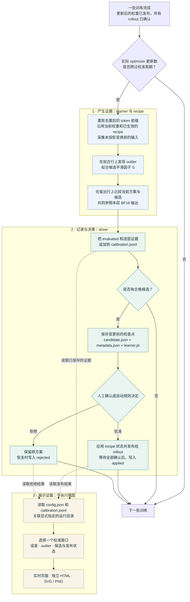
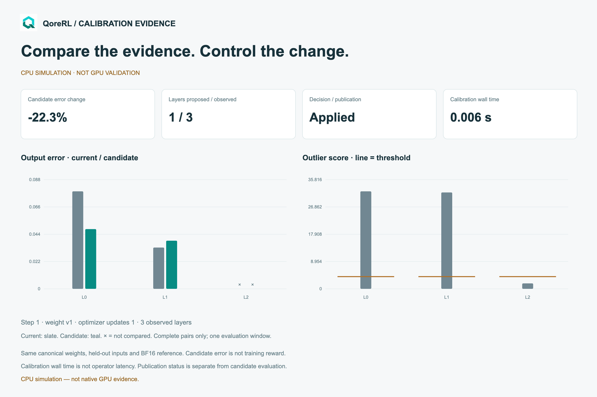

# SmoothQuant 校准：从训练输入到可见的决策

[English](smoothquant-calibration.md) · **简体中文**

这条链路有三个分工：**learner 和 recipe 负责产生校准证据，driver 负责记录、审核和发布变更，展示模块负责读取与呈现证据。** 打开页面、刷新图表、导出报告，都不会重新加载模型或再执行一次 GPU 校准。真正的校准过程本身，则需要额外的前向计算。

本文按照这三个分工解读当前代码，重点说明数据从哪里来、怎样写入文件、怎样变成图表。配置与硬件准备见 [SmoothQuant 使用指南](recipes/dynamic-smoothquant.zh-CN.md)，原生实验验收见 [GPU 验证指南](gpu-validation.zh-CN.md)。下文可复现的例子使用真实 CPU 训练流程和量化模拟，不是原生 GPU 测量。

## 1. 先看完整链路



人工确认模式的“暂停”，目前是**训练进程退出并释放 workers**。用户检查候选后，通过明确的接受或拒绝命令，恢复到一个新的输出目录。自动批准则在当前运行中走同一条保存、应用和发布链路。只发现异常的模式到记录 outlier 证据为止，不产生候选。

## 2. 如何进行校准

### 确定范围、周期和批准方式

下面是放进训练配置的片段。层号从 0 开始；低精度范围固定，SmoothQuant 初始覆盖其中一部分层：

```json
{
  "recipe_id": "smoothquant-mlp-down-v1",
  "recipe_options": {
    "precision": "mxfp8",
    "layers": [7, 15, 20, 25],
    "smoothquant_layers": [7, 15, 20],
    "allow_layer_expansion": true
  },
  "recipe_calibration": {
    "refresh_every_optimizer_steps": 20,
    "discover_outliers": true,
    "discovery_only": false,
    "outlier_threshold": 4.0,
    "alpha": 0.5,
    "max_rows": 128,
    "min_relative_improvement": 0.0,
    "max_activation_relative_l2": 0.05,
    "approval": "manual"
  }
}
```

第 7、15、20、25 层从启动起都使用 MXFP8，只有第 7、15、20 层最初叠加 S。允许扩展后，观察这四层，可以为第 25 层提出启用 S 的候选。扩展**不会把范围外的 BF16 层改成低精度，也不会改用 Hadamard**。禁止扩展时，只观察已经启用 SmoothQuant 的层。示例中的首次激活误差上限为 5%；该参数默认是 `null`，即不额外设置上限。

driver 在本批训练更新和常规权重发布后，调用 `crosses_interval(before, after, interval)`。正周期下判断 `before // interval < after // interval`。这里数的是**实际执行的 optimizer 更新**，不是 rollout 批数、microbatch 数或页面刷新次数。从 19 次更新变成 22 次，会在这个批次边界校准一次；没有执行 optimizer 更新的批次，不会推进校准计数。恢复训练后沿用已保存的计数。

对应代码：[校准配置与通用发现](../qorerl/recipes/calibration.py)、[RecipeState 的观测范围](../qorerl/recipes/state.py)、[周期判断](../qorerl/runtime/calibration.py)、[训练 driver](../qorerl/runtime/ray_runtime.py)。

### 从刚训练完的 batch 收集输入

`SingleRankGRPOLearner.prepare_candidate(batch)` 先检查样本策略，再采集输入，最后通过 `RecipeSpec.candidate_handler` 调用具体 recipe。SmoothQuant 自己实现拟合和应用，driver 不计算 S。

learner 用更新后的模型重放**已经采样出的 token**，不会让 rollout 再生成新回答。`_calibration_prefixes` 从 `prompt_ids + response_ids[:-1]` 构造上下文，去掉重复的因果前缀，并限制新增 token 行数。`_sample_calibration_inputs` 在 `no_grad` 下逐条重放无 padding 的序列，每个观测投影最多保留 `max_rows` 行。

重放沿用**当前已经生效的执行配置**。在上面的例子中，第 7、15、20 层的 `down_proj` 使用 MXFP8 和当前的平滑因子 `S_old`；第 25 层的 `down_proj` 在获批启用 SmoothQuant 之前使用直接 MXFP8。低精度范围之外的投影保持 BF16 路径。采集时不会把整模型切回 BF16，也不会安装候选因子。

原生训练端的 `MegatronRecipeInstallation.forward` 在调用 `transform_input` 和 `transform_weight` **之前**执行 `calibrator.capture(name, x)`，复制目标 `down_proj` 的输入，再按当前 recipe 继续前向。这不是在收集整个 Transformer block 的输出：Attention 和 MLP 中的其他运算也参与产生这个输入。采集器对保留的行执行 detach 和 clone，因此后面的变换不会覆盖已保存的数据。

所以，X 尚未经过**这个投影自身的** SmoothQuant 变换，但已经包含上游各层的影响，包括它们的量化影响。X 用 BF16 存储，不代表它来自一个全 BF16 模型。用于比较的 W 是当前模型尚未经过本地 recipe 变换的 BF16 权重，形状为 `[输出通道数, 输入通道数]`。

`activation_windows` 按顺序划分这些行：前 `floor(n / 2)` 行用于拟合，其余行用于留出比较。相同 token 前缀不会重复进入两个集合，但它们仍可能来自同一条回答，不能视为独立的任务验证集。只发现异常时，全部行都用于发现。

driver 同时记录 `sample_policy`（生成这些 token 的策略）和 `policy`（本次评估使用的更新后策略）。原始激活矩阵与重放输出是临时内存数据；**`calibration.jsonl` 保存的是证据摘要，不是完整的激活数据集**。

对应代码：[前缀重放与采集](../qorerl/engines/single_rank_learner.py)、[原生投影适配](../qorerl/recipes/megatron_mxfp8.py)、[recipe 分派](../qorerl/recipes/spec.py)。

### 发现 outlier、拟合 S，再比较候选

对于每个输入通道 j，拟合过程计算：

```text
x_max[j] = 拟合行中 abs(X[:, j]) 的最大值
w_max[j] = 所有输出通道中 abs(W[:, j]) 的最大值
outlier_score = max(x_max) / mean(x_max)
S_new[j] = x_max[j]^alpha / w_max[j]^(1 - alpha)
```

outlier 分数描述本层各输入通道幅度的不均衡程度，不是 outlier token 的比例。激活或权重没有有效非零信号的通道沿用原平滑因子，首次激活的层从全 1 开始。拟合使用 FP64 运算，最终保存正的 FP32 因子。新 S 相对于原始 W 定义，刷新时替换原值，不是在旧 S 上反复相乘。

**S 是 SmoothQuant 平滑因子，不是量化器的 scale。** 沿输入通道配对执行 `X / S` 和 `W * S` 后，量化器再针对变换后的操作数计算自己的 block scales。在精确算术下，这组变换保持线性输出不变；实际有舍入与量化误差，因此仍须测量。

对每个入选层，以下比较使用**同一份留出 X 和原始 W**：

| 比较对象 | 怎么计算 |
| --- | --- |
| 本层参考输出 | BF16 的 `Y_ref = F.linear(X_heldout, W)` |
| 当前方案：`refresh` | 用本层已有 S 执行低精度前向 |
| 当前方案：`activate` | 直接执行低精度前向，不叠加 SmoothQuant |
| 候选方案 | 用 `X_heldout / S_new` 和 `W * S_new` 执行同一个低精度 kernel |

误差为 `||Y - Y_ref||₂ / ||Y_ref||₂`。只有候选误差严格下降、相对降幅 `(before - after) / before >= min_relative_improvement`，且因子确实改变，才进入提案。首次激活还必须有 outlier 证据，并满足配置的 `max_activation_relative_l2` 上限。`discover_outliers: false` 允许已有 SmoothQuant 层跳过 outlier 阈值筛选，新激活层仍需通过该阈值。

`prepare_smoothquant_candidate` 返回**合格层的因子向量**和**全部观测层的证据**，不会修改已安装的状态。有明显 outlier 的层，也可能得到 `no_gain`。CPU 测试注入模拟 kernel，原生适配器传入其所选低精度 kernel。

对应代码：[`activation_windows`](../qorerl/recipes/calibration.py)、[`prepare_smoothquant_candidate`、`_fit_smoothing_factor`、`_measure_output_relative_l2`](../qorerl/recipes/smoothquant.py)。

### 为什么使用局部 BF16 对照

当前比较要回答的问题是：**面对当前训练配置实际产生的输入，改变这个投影的 S，能否降低其前向误差？** 比较固定了采集输入、当前原始权重和低精度 kernel，只改变平滑因子。这样可以单独观察这组输入上的局部改动效果；它不是整模型消融实验，也不能保证对训练的影响最小。

| 对照方式 | 输入和执行方式 | 能说明什么 |
| --- | --- | --- |
| **局部 BF16 对照：已实现** | 复用当前 recipe 下采集的 X，只对这个投影执行 BF16 的 `F.linear(X, W)`。 | 为同一输入上的旧 S、新 S 提供共同参考。X 中仍保留上游低精度计算的影响。 |
| **整模型 BF16 重放：当前校准链路不执行** | 用同一份当前权重，让记录的 token 在整个 BF16 模型上前向，另外采集 `X_bf16`。 | 提供排除了上游低精度量化影响的诊断参考，观察当前权重在 BF16 执行下的行为。 |

整模型 BF16 的输入仍然取决于前面各层的权重、Attention、非线性运算以及 BF16 舍入。有些 outlier 在这种计算下本来就存在，有些则可能由当前路径中的上游量化引入或放大。整模型 BF16 重放可以帮助研究这种区别，但它没有消除全部上游影响，也不能单独定位训练失败的根因。而且，当前权重已经包含此前训练的历史；切回 BF16 重放，无法还原“假如从一开始就用 BF16 训练，此时会得到的模型”。

在 `X_bf16` 上拟合，面向的是另一种输入分布，与低精度模型当前实际遇到的输入可能不同，因此它不自动成为更好的校准数据来源。当前设计选择实际执行路径中的输入，再用共同的局部 BF16 输出比较候选。旧方案、参考和候选执行的是留出行上的**投影计算**，不会分别运行三个完整模型，也不会把比较结果继续传入后面的层。

### 多个层同时通过时，会发生什么

候选按层评估，但一个 artifact 可以包含**多个合格层**，获批后将这些更新一起合并到当前状态中。以第 7、20 层为例：

1. 按当前 recipe 重放，得到 `X7_old` 和 `X20_old`。第 7 层的新 S 在 `X7_old` 上比较，第 20 层的新 S 在 `X20_old` 上比较。准备期间，各层实际安装的平滑因子始终不变。
2. 如果两层都通过，候选包含两处更新。应用后，第 7 层的新 S 可能改变其量化输出；变化经过中间各层的计算，传到第 20 层时，输入可能已经变成 `X20_new`，不再是当初评估候选时的 `X20_old`。

第 20 层在 `X20_old` 上改善，不能证明它在 `X20_new` 上也改善。**逐层比较都更好，不保证组合后的整模型更好。** 当前实现不会每提出一处上游变更就重新校准下游，也没有在发布前重放完整候选组合。后续校准可以观测更新后的执行路径，但这不能在中间那些训练批次运行之前验证组合效果。

因此，页面上的逐层柱状图和均值，应理解为此前采集输入上的对照，不能解释为已发布组合的端到端收益。协同发布保证 learner 和 rollout 确认同一份 recipe 状态，不代表这个组合的数值或任务效果已经得到验证。

整模型候选验证已[记入后续计划](../todo.md#p1--observe-pause-adjust-and-resume)，暂不开发。它将固定权重，在留出的 token 序列上比较当前配置与完整候选组合，让两次执行各自产生下游激活。这个步骤与局部 BF16 对照、可选的整模型 BF16 诊断参考分别承担不同职责，当前尚未实现。

## 3. 如何写入校准数据、候选和决策

### 几个文件各自保存什么

```text
results/sq-review/
├── config.json
├── calibration.jsonl
├── publications.jsonl
├── trajectories.jsonl
├── summary.json
└── checkpoints/step-000001-before-calibration/
    ├── metadata.json
    ├── candidate.json
    └── learner.pt
results/sq-accepted/                 # 人工恢复后使用新的输出目录
├── config.json
├── calibration.jsonl               # applied/rejected，以及到期后的新评估
├── publications.jsonl
└── trajectories.jsonl
```

上面只列出人工审核流程中的相关文件，不是完整目录清单。

| 文件 | 谁写入，保存什么 | 校准页面会读取吗？ |
| --- | --- | --- |
| `config.json` | driver：解析后的配置，用于识别配置的 backend 和 recipe。 | 会 |
| `calibration.jsonl` | driver：逐行追加评估、逐层证据和决策事件；一行一个完整 JSON 对象。 | 会 |
| `candidate.json` | 检查点写入器：候选 artifact、证据、源策略、评估 ID 和 learner 文件摘要。 | 不会；用于审核和恢复 |
| `metadata.json` | 检查点写入器：进度、策略、配置、保存边界和待审核候选 ID。 | 不会；用于恢复 |
| `learner.pt` | learner：模型、主参数、optimizer、计数器、recipe 状态及其他恢复状态。 | 不会 |
| `publications.jsonl` | driver：发布的策略和每个 rollout 的确认。 | 不会；核对发布时查看 |
| `trajectories.jsonl` | driver：采样 token、奖励、优势和生成它们的策略。 | 不会；核对下一批策略时查看 |
| `summary.json` | driver：完成/暂停状态、检查点路径和待审核候选 ID。 | 不会；用于操作运行 |

出错时，`incident.json` 记录异常和恢复点。页面检查该文件是否存在并提示异常，不会执行恢复训练。

### 逐层证据样例

以下是**说明格式的示例**，为了阅读进行了缩进，实际 JSONL 中整个对象只占一行。ID 是占位值，数值不是 GPU 实验结果。真实 `evidence` 数组包含全部观测层。

```json
{
  "event": "evaluated",
  "evaluation_id": "example-evaluation-001",
  "step": 20,
  "policy": {"weight_version": 20, "recipe_id": "<active-recipe-before>"},
  "sample_policy": {"weight_version": 19, "recipe_id": "<active-recipe-before>"},
  "optimizer_steps": 20,
  "evaluation_seconds": 0.25,
  "evidence": [{
    "target": "model.layers.7.mlp.down_proj.weight",
    "action": "refresh",
    "selection": "outlier",
    "outlier_score": 12.0,
    "threshold": 4.0,
    "alpha": 0.5,
    "fit_rows": 64,
    "heldout_rows": 64,
    "status": "proposed",
    "reason": null,
    "current_relative_l2": 0.08,
    "candidate_relative_l2": 0.05,
    "relative_improvement": 0.375
  }]
}
```

8% 和 5% 都是相对于本层 BF16 输出的误差，相对改善是 37.5%，不是 3%。首次激活时，原始证据还记录 `direct_low_precision_relative_l2` 和 `max_activation_relative_l2`。

**逐层状态**和**运行级事件**回答不同问题：

| 逐层 `status` | 含义 |
| --- | --- |
| `discovered` | 被发现阶段选中；只发现模式可以到这里结束。 |
| `not_selected` | 未达到发现阈值，没有比较候选误差。 |
| `proposed` | 通过局部比较，尚不能说明已经应用。 |
| `no_gain` | 没有严格改善、降幅不足，或因子未改变；已测得的两份误差仍保留。 |
| `activation_cost_exceeded` | 首次激活虽有改善，误差仍超上限。此处 cost 指误差，不是耗时或 FLOPs。 |
| `insufficient_rows`、`insufficient_signal`、`invalid_candidate` | 输入证据或候选不可用，原因写在 `reason`。 |

| 运行级 `event` | driver 什么时候写 |
| --- | --- |
| `evaluated` | learner 准备完成后；没有合格候选也记录证据。 |
| `awaiting_review` | 候选和变更前检查点保存后，随后退出等待审核。 |
| `applied` | 提案已应用，所需发布及全部 rollout 确认已完成。 |
| `rejected` | 恢复时明确拒绝，继续使用检查点中的原方案。 |
| `imported` | 启动时应用离线 artifact，并在首次采样前发布后；没有新测得的比较。 |

`append_json` 使用 `allow_nan=False` 序列化并追加换行符。learner 通过 Ray 返回 artifact 和 evidence，driver 统一写日志。这不是事务数据库。检查点先写临时目录，文件齐全后再通过目录改名对外可见。

### 审核必须绑定当时的模型状态

schema-2 的 `candidate.json` 外层包含 `source_policy`、`optimizer_steps`、`candidate`、`evidence`、`evaluation_id` 和 `checkpoint_sha256`。内层 SmoothQuant artifact 包含模型及 revision、基础 recipe 身份、各目标层的因子向量和摘要。候选映射只含合格层；检查点另行保留全部已生效 recipe 状态。

artifact 为兼容仍使用 schema-1 的 `kind: "smoothquant_scales"`、`scales`、`scale_digest` 字段。它们保存的是 **SmoothQuant 平滑因子**，不是量化器的 scale。Python 使用 `smoothing_factors` 命名，JSON 保留已有交换格式。

`candidate_id` 是整个审核对象序列化后的 SHA-256，其中包含 learner 检查点摘要。它保存在 `metadata.pending_candidate`，并出现在 `summary.json` 和相关事件中。恢复时核对审核 ID、源策略、用户传入的决策 ID 和 `learner.pt` 摘要。不要在确认 ID 后手工修改候选文件。旧 schema-1 审核对象仍可从原 `scale_artifact` 字段读取。

接受候选后，recipe 检查并把新因子合并进 `RecipeState`。只更新 S 不会执行 optimizer 更新，因此 `weight_version` 可以不变，S 的内容摘要却改变，`recipe_id` 随之改变。rollout 必须收到新状态，重新构建变换并打包后的权重。全部副本确认预期策略后，下一批才开始采样。发布失败时 driver 停止并记录恢复点，不会在版本不一致时继续训练。

对应代码：[审核与校验](../qorerl/runtime/calibration.py)、[检查点写入](../qorerl/runtime/checkpoint.py)、[应用、发布与日志](../qorerl/runtime/ray_runtime.py)、[recipe 应用](../qorerl/recipes/smoothquant.py)、[rollout 打包](../qorerl/recipes/vllm_mxfp8.py)。

## 4. 如何展示已有校准数据



`qorerl inspect` 启动 `observability/viewer.py` 中的本地 HTTP 服务。`load_report` 调用 `load_calibration`，读取主目录和显式指定的 `--related-run` 目录，渲染 `calibration.html`。实时页面每两秒请求一次 `/api/report`，发现新事件就更新图表。这是**实时读取日志**，不是持续重新校准模型。

### 一个窗口内比较，生效状态单独显示

每个 `evaluated` 事件成为一个可选窗口。页面显示运行段、训练批次、optimizer 计数、评估策略和采样策略。第一张图用成对柱状图比较当前/候选误差，第二张图显示 outlier 分数和阈值。层表列出 `activate`/`refresh`、拟合/留出行数、状态和原因，事件表另行显示关联的审核及发布结果。

摘要取**本窗口全部完整比较对**的当前误差均值和候选误差均值，各层权重相同，包含 `no_gain` 候选。显示值为 `(mean_candidate - mean_current) / mean_current * 100`。页面上的误差下降是负值，证据中的 `relative_improvement` 则为正值。这个摘要既不是最终应用组合的收益，也不是各层改善百分比的平均。“Proposed / observed”的分母是本窗口 evidence 条数，不是模型总层数。

缺失测量保留 `null`，显示为 `—` 或 `×`，不会补零；不同权重版本不会拼成一次比较。读取器按成对误差重新计算相对改善。`evaluation_seconds` 是准备过程的墙钟时间，包含 driver/Ray 等待；`apply_publish_seconds` 是应用和发布的墙钟时间。它们都不是算子耗时，也不代表节省的运算量。

### 跨恢复目录关联一次决策

原运行写 `evaluated`、`awaiting_review`，恢复运行在自己的目录写 `applied` 或 `rejected`。需要明确提供两者：

```bash
uv run qorerl inspect --run results/sq-accepted \
  --related-run results/sq-review --view calibration --port 8765
```

`evaluation_id` 串联评估、审核对象和决策，`candidate_id` 关联同一保存提案的结果。旧日志没有 evaluation ID 时，先在**同一运行段内**关联此前同一步的评估，再用相同 candidate ID 连接显式提供的运行段。不会因为两个目录 step 相同就猜测是同一次评估，也不会自动打开日志中记录的路径。提供多条决策分支时显示 `multiple_branches`，不把某条分支覆盖成唯一结果。

实时读取中，`read_events` 暂缓解析末尾尚未写完换行符的一行，完成但格式有误的记录产生警告。每个 JSONL 最多读取末尾 16 MiB，截断历史时明确提示。来源标签按每段 backend 配置区分 `cpu_simulation`、`native_gpu`、`unknown`，不是 GPU 验收证明。

### 不重跑校准，直接导出

| 输出 | 实现及内容 |
| --- | --- |
| CLI HTML | `export_report` 嵌入已加载证据、页面代码和 logo，关闭轮询；浏览不需要模型、检查点张量或网络。 |
| 页面 **Save HTML** | 保存当前报告及所选窗口为离线快照。 |
| 页面 **SVG** | `exportSvg` 绘制所选窗口的来源、摘要、误差/outlier 图和口径说明，1200 × 800。 |
| 页面 **PNG** | 浏览器 canvas 将同一 SVG 栅格化为 2400 × 1600 图片。 |

图片是所选窗口的摘要，不是完整事件归档；需要其他窗口或详细结果时，同时保留 JSONL 和 HTML。页面不会调用 `prepare_candidate` 或 `apply_candidate`，审核仍通过明确的训练命令执行。

对应代码：[读取与关联](../qorerl/observability/calibration.py)、[HTTP 服务及 HTML 导出](../qorerl/observability/viewer.py)、[图表、轮询和图片导出](../qorerl/observability/calibration.html)、[CLI](../qorerl/cli.py)。

## 5. 在 CPU 上走一遍完整流程

在已安装项目环境的仓库根目录执行，每次训练输出目录必须是新的。[CPU 配置](../configs/grpo_cpu_smoothquant.json)使用微型模型和低精度模拟，三层初始都启用 SmoothQuant，每次实际更新后校准。

```bash
uv run qorerl train --config configs/grpo_cpu_smoothquant.json --out results/sq-review
uv run qorerl inspect --run results/sq-review --view calibration --port 8765
```

打开 `http://127.0.0.1:8765`，检查第一个窗口和保存的 `candidate.json`。另开终端，读取准确的恢复点与候选 ID：

```bash
CP=$(uv run python -c 'import json; print(json.load(open("results/sq-review/summary.json"))["checkpoint"])')
ID=$(uv run python -c 'import json; print(json.load(open("results/sq-review/summary.json"))["candidate_id"])')
uv run qorerl train --config configs/grpo_cpu_smoothquant.json \
  --resume "$CP" --accept-candidate "$ID" --out results/sq-accepted
uv run qorerl report --run results/sq-accepted --related-run results/sq-review \
  --view calibration --out results/sq-calibration.html
```

在报告中选择**原始评估窗口**查看其 `Applied` 决策；后续窗口可能有不同结果。使用 SVG/PNG 按钮导出该窗口。实时查看两段运行时，先停止原 viewer，再执行第 4 节命令。若要拒绝，从同一个变更前检查点恢复到另一个新目录，改用 `--reject-candidate "$ID"`。

本次编写文档时重新执行 CPU 配置，首个窗口结果如下，每层有 4 行拟合、5 行留出；数值仅属于这个模拟用例：

| 层 | Outlier 分数 | 当前相对 L2 | 候选相对 L2 | 结果 |
| --- | ---: | ---: | ---: | --- |
| 0 | 31.98 | 0.078228 | 0.047923 | `proposed`：提出刷新 |
| 1 | 31.62 | 0.033125 | 0.038617 | `no_gain`：保留原 S |
| 2 | 1.78 | — | — | `not_selected`：未进入候选比较 |

接受后，第一个窗口关联到 `applied`，恢复运行完成到第 3 批，HTML 导出成功。这个例子说明：**发现 outlier、候选通过、发布生效是三件事，不能用一个“成功”混在一起。**

验证时分别检查：（1）证据说明哪层通过；（2）`applied` 和 `publications.jsonl` 说明新策略已发布；（3）下一批轨迹携带该策略。现有[流程测试](../tests/test_calibration_workflow.py)还比较人工接受与自动批准后的训练结果，并覆盖低精度范围内首次激活。[展示测试](../tests/test_calibration_viewer.py)覆盖跨目录关联、多分支、未完成日志和独立导出。

## 6. 这些数据能说明什么

校准测量的是**当前 recipe 所产生的采样输入上的局部前向误差**。如第 2 节所述，BF16 参考只作用于局部，多层一起应用还可能改变下游输入。它不能直接定位整次训练失败的根因，没有测量梯度误差，也不能证明奖励、收敛、FLOPs 或吞吐改善。整模型候选验证仍是待办；即使增加这个步骤，也不能替代训练层面的质量与成本评估。

SmoothQuant 展示读取 `calibration.jsonl`，**不需要**另开 `recipe_observation` 探针。后者比较固定 BF16/MXFP8/Hadamard 方案并写入 `recipe_metrics.jsonl`；给 SmoothQuant 开这个探针并不是获得本文图表的方式。那条独立链路见 [Recipe Insights](recipe-insights.zh-CN.md)。

原生验证使用[单 GPU 配置](../configs/grpo_single_gpu_smoothquant.json)和 [GPU 验收指南](gpu-validation.zh-CN.md)。同时保留配置、校准证据、发布记录、轨迹和训练指标。CPU 模拟或“原生配置目录”产生的图，不能当作已经验证的 GPU 训练收益。
